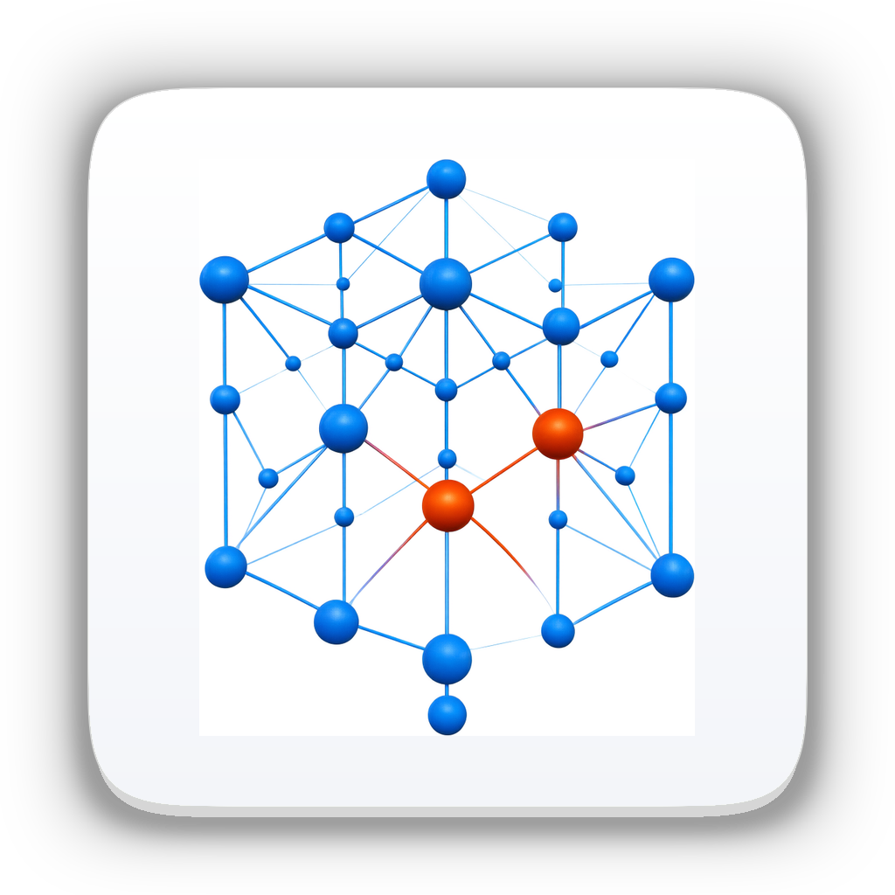

<div align="center">



# EigenGraph
### Computational Framework for Structural Robustness, SVD Kinematic Mechanism Guards, and Adjusted Redundancy Index (ARI)

[](https://github.com/haridsirawan/EigenGraph/releases/tag/v1.0.0)
[-black.svg)](#)
[](LICENSE)
[](#)

*Authored and developed by **Harids Irawan** as a computational testbed and demonstration for Doctoral Dissertation research in Structural Redundancy, Progressive Collapse Prevention, and 5D BIM Optimization.*

</div>

---

## 🎯 Latar Belakang Riset & Paradigma Baru (Why EigenGraph?)

Selama lebih dari empat dekade, perangkat lunak analisis struktur komersial (**SAP2000, ETABS, STAAD.Pro, MIDAS, Revit**) beroperasi menggunakan paradigma berbasis kapasitas tunggal (*Capacity-Centric Design*):

$$DCR = \frac{\text{Demand}}{\phi \cdot \text{Capacity}} \le 1.0$$

### Kelemahan Mendasar Desain Konvensional:
1. **Buta Terhadap Keruntuhan Progresif (*Progressive Collapse Blindness*)**:  
   Sebuah struktur dengan rasio utilisasi sangat rendah ($DCR = 0.40$) dapat **runtuh secara katastropik (*zipper-type collapse*)** jika salah satu elemen penahan beban utamanya terputus akibat impak, gempa, kelelahan bahan (*fatigue*), atau ledakan, karena tidak memiliki jalur transfer beban alternatif (*Alternative Load Paths*).
2. **Kekeliruan Derajat Ketidaktentuan Statis Klasik**:  
   Anggapan klasik bahwa struktur dengan derajat ketidaktentuan statis tinggi ($D = b + r - 2j > 0$) pasti aman adalah keliru. Jika elemen redundan berada pada posisi yang tidak efektif, kehilangan satu batang kunci tetap dapat memicu keruntuhan lokal atau pembentukan mekanisme goyang (*kinematic mechanism*).
3. **Ketidakmampuan Mengukur Redundansi Nyata**:  
   Standar internasional modern (**DoD UFC 4-023-03, ASCE 7-22 Section 1.4, fib Model Code 2020**) mewajibkan verifikasi integritas struktural dan ketahanan terhadap keruntuhan progresif, namun belum ada indeks kuantitatif praktis yang menghubungkan kekakuan matriks global, redistribusi gaya, dan implikasi biaya konstruksi.

**EigenGraph** dirancang khusus untuk memecahkan persoalan ini melalui formulasi **Adjusted Redundancy Index (ARI)** dan **SVD Kinematic Mechanism Guard**.

---

## 🔬 Formulasi Lengkap Matematika & Mekanika ARI

EigenGraph memodelkan struktur sebagai graf matematis berdimensi tinggi $\mathcal{G} = (\mathcal{V}, \mathcal{E})$ dengan matriks kekakuan elastis linier.

```
                  ┌─────────────────────────────────────────────────────────┐
                  │              STRUKTUR UTUH (INTACT MODEL)               │
                  │              K_ff · u_f = F_f  ==> U_e^(0)              │
                  └───────────────────────────┬─────────────────────────────┘
                                              │
                       Perturbasi Pelepasan Batang Tunggal (Member Elimination)
                                      K_ff^(-e) = K_ff - k_e,ff
                                              │
                                              ▼
                  ┌─────────────────────────────────────────────────────────┐
                  │             GATE 1: SVD KINEMATIC GUARD                 │
                  │            K_ff^(-e) = U · Σ · V^T                      │
                  │   Apakah rank(K_ff^(-e)) == n_free? (Zero Mechanism)    │
                  └─────────────┬─────────────────────────────┬─────────────┘
                                │                             │
                           TIDAK (Labil)                  YA (Stabil)
                                │                             │
                                ▼                             ▼
                  ┌───────────────────────────┐ ┌───────────────────────────┐
                  │         ARI_e = 0.0       │ │   GATE 2: FEM REDISTRIBUSI│
                  │    (Batang Kritis Runtuh) │ │  K_ff^(-e) · u^(-e) = F_f │
                  └───────────────────────────┘ │    U_max^(-e) = max(U_j)  │
                                                └─────────────┬─────────────┘
                                                              │
                                                              ▼
                                                ┌───────────────────────────┐
                                                │ GATE 3: FORMULASI ARI     │
                                                │ ARI_e = 1 - ΔU / Reserve  │
                                                │ Nilai: 0.0 s/d 1.0        │
                                                └───────────────────────────┘
```

---

### 1. Partisi Matriks Kekakuan Global & Solusi FEM
Berdasarkan metode kekakuan langsung (*Direct Stiffness Method*), persamaan kesetimbangan global dipartisi berdasarkan derajat kebebasan bebas (*free*, $f$) dan terkekang (*restrained*, $r$):

$$\begin{bmatrix} \mathbf{K}_{ff} & \mathbf{K}_{fr} \\ \mathbf{K}_{rf} & \mathbf{K}_{rr} \end{bmatrix} \begin{bmatrix} \mathbf{u}_f \\ \mathbf{u}_r \end{bmatrix} = \begin{bmatrix} \mathbf{F}_f \\ \mathbf{F}_r \end{bmatrix}$$

Dengan kondisi batas tumpuan ideal $\mathbf{u}_r = \mathbf{0}$, perpindahan simpul aktif dihitung melalui eliminasi Gauss dengan *partial pivoting*:

$$\mathbf{u}_f = \mathbf{K}_{ff}^{-1} \mathbf{F}_f$$

Gaya aksial pada setiap elemen batang $e$ dihitung dari perpindahan simpul ujung 1 dan 2 dalam koordinat lokal:

$$N_e = \frac{E_e A_e}{L_e} \left( u_{2,\text{axial}} - u_{1,\text{axial}} \right)$$

Tingkat pembebanan / utilisasi awal (*baseline utilization*) elemen $e$:

$$U_e^{(0)} = \frac{|N_e^{(0)}|}{\phi P_{n,e}} \in [0.0, 1.0]$$

di mana $\phi P_{n,e}$ adalah kapasitas nominal penampang sesuai standar **SNI 1729:2020 / AISC 360-16 LRFD** ($\phi_t = 0.90$ untuk tarik, $\phi_c = 0.90$ untuk tekuk aksial Euler).

---

### 2. SVD Kinematic Mechanism Guard (Gate 1)
Sebelum beban luar didistribusikan, kestabilan kinematik matriks kekakuan diperiksa menggunakan **Two-Sided Jacobi Singular Value Decomposition (SVD)**:

$$\mathbf{K}_{ff} = \mathbf{U} \mathbf{\Sigma} \mathbf{V}^T = \sum_{k=1}^{n_{\text{free}}} \sigma_k \mathbf{u}_k \mathbf{v}_k^T$$

dengan nilai singular terurut $\sigma_1 \ge \sigma_2 \ge \dots \ge \sigma_{n_{\text{free}}} \ge 0$.

* **Pemeriksaan Rank Numerik**:
  $$\text{rank}(\mathbf{K}_{ff}) = \sum_{k=1}^{n_{\text{free}}} \mathbb{I}\left( \sigma_k > \varepsilon_{\text{tol}} \cdot \sigma_1 \right), \quad \varepsilon_{\text{tol}} = 10^{-7}$$
* **Sertifikasi Kestabilan**:
  $$\text{rank}(\mathbf{K}_{ff}) = n_{\text{free}} \implies \text{Struktur Stabil Kinematik (Bebas Mekanisme Goyang)}$$
* **Deteksi Vektor Mekanisme Keruntuhan**:
  Jika terdapat nilai singular mendekati nol ($\sigma_k \le \varepsilon_{\text{tol}} \cdot \sigma_1$), dimensi *nullspace* $\text{dim}(\text{Null}(\mathbf{K}_{ff})) > 0$, dan kolom $\mathbf{v}_k$ pada matriks $\mathbf{V}$ merepresentasikan **bentuk deformasi fisik mekanisme keruntuhan (*rigid-body collapse mode*)**.
* **Angka Kondisi (*Condition Number*)**:
  $$\kappa(\mathbf{K}_{ff}) = \frac{\sigma_1}{\sigma_{n_{\text{free}}}}$$

---

### 3. Operator Perturbasi Pelepasan Batang Tunggal ($\mathcal{P}_e$)
Untuk menguji redundansi riil elemen $e$, model struktur dimodifikasi secara numerik dengan melepaskan elemen $e$ (*sudden member loss*):

$$\mathbf{K}_{ff}^{(-e)} = \mathbf{K}_{ff} - \mathbf{k}_{e,ff}$$

Sistem persamaan kesetimbangan pada kondisi rusak dievaluasi:

$$\mathbf{K}_{ff}^{(-e)} \mathbf{u}_f^{(-e)} = \mathbf{F}_f$$

#### Kondisi Pembatalan (Gate 1):
Jika $\text{rank}(\mathbf{K}_{ff}^{(-e)}) < n_{\text{free}}$ atau solver mengalami divergensi singular:
$$ARI_e = 0.0 \quad (\text{Batang Kritis: Keruntuhan Mekanisme Langsung})$$

---

### 4. Formulasi Adjusted Redundancy Index (ARI)
Jika struktur tetap stabil setelah batang $e$ hilang, gaya dalam diredistribusikan ke seluruh elemen yang tersisa $j \neq e$. Utilisasi maksimum baru pada elemen penopang adalah:

$$U_{\max}^{(-e)} = \max_{j \neq e} U_j^{(-e)}$$

Kenaikan utilisasi yang terjadi pada elemen sekitarnya:

$$\Delta U_e = \max\left(0.0, \, U_{\max}^{(-e)} - U_e^{(0)}\right)$$

Kapasitas cadangan (*reserve capacity*) dari elemen yang diuji:

$$\text{Reserve}_e = \max\left(1.0 - U_e^{(0)}, \, \delta_{\min}\right), \quad \delta_{\min} = 0.05$$

**Indeks Redundansi Terkoreksi (Adjusted Redundancy Index - ARI)** untuk elemen $e$ dirumuskan sebagai:

$$\boxed{ARI_e = \begin{cases} 0.0, & \text{jika } \text{rank}(\mathbf{K}_{ff}^{(-e)}) < n_{\text{free}} \quad \text{atau} \quad U_{\max}^{(-e)} \ge 1.0 \\ 1.0 - \dfrac{\Delta U_e}{\text{Reserve}_e}, & \text{jika struktur stabil dan } U_{\max}^{(-e)} < 1.0 \end{cases}}$$

$$ARI_e \in [0.0, \, 1.0]$$

---

### 5. Parameter Turunan: Redundancy Ratio ($RR$), Criticality ($CI$), dan SVD Margin ($m_e$)

* **Redundancy Ratio ($RR_e$)**:  
  Tingkat konservasi kapasitas tegangan elemen penopang:
  $$RR_e = \max\left(0.0, \, 1.0 - |U_{\max}^{(-e)} - U_e^{(0)}|\right)$$

* **Criticality Index ($CI_e$)**:  
  Tingkat keparahan dampak kegagalan batang terhadap integritas global:
  $$CI_e = 1.0 - RR_e$$

* **SVD Safety Margin ($m_e$)**:  
  Margin kestabilan numerik matriks kekakuan saat perturbasi:
  $$m_e = \text{clamp}\left( \frac{1}{\log_{10}(\kappa^{(-e)}) / 12.0}, \, 0.0, \, 1.0 \right)$$

* **Indeks Redundansi Sistem Global ($ARI_{\text{sys}}$)**:
  $$ARI_{\text{sys}} = \min_{e \in \mathcal{E}} ARI_e$$
  $$\overline{ARI} = \frac{1}{|\mathcal{E}|} \sum_{e \in \mathcal{E}} ARI_e$$

---

### 6. Klasifikasi Tingkat Keamanan Redundansi

| Rentang Nilai $ARI$ | Kategori Keamanan | Karakteristik Perilaku Struktur | Rekomendasi Desain |
| :---: | :---: | :--- | :--- |
| **$0.85 \le ARI \le 1.00$** | 🟢 **Grade A: Highly Redundant** | Redistribusi beban sangat lancar, kenaikan tegangan batang sekitar $< 15\%$. Tidak ada risiko unzipping. | Struktur optimal, layak untuk infrastruktur vital/strategis. |
| **$0.70 \le ARI < 0.85$** | 🟡 **Grade B: Code Compliant** | Memenuhi standar batas minimum keruntuhan. Batang sekunder menampung tegangan cadangan. | Desain standar SNI/AISC aman, namun perlu monitoring berkala. |
| **$0.00 \le ARI < 0.70$** | 🔴 **Grade C/D: Critical Fracture Point** | **Titik Kegagalan Tunggal (*Single Point of Failure*)**. Kehilangan elemen memicu keruntuhan beruntun. | **Wajib Didesain Ulang**: perbesar profil atau tambah jalur batang alternatif (*dual-path*). |

---

### 7. Optimasi Rekayasa Nilai: Sensitivitas Biaya (RAB 5D) vs. ARI
Salah satu kontribusi utama disertasi ini adalah menghubungkan **Indeks Redundansi (ARI)** dengan **Estimasi Biaya Konstruksi 5D (AHSP)**:

$$\text{Sensitivitas } \mathcal{S} = \frac{\Delta ARI_{\text{sys}}}{\Delta \text{RAB}_{5D}} \quad \left[ \frac{\text{Poin ARI}}{\text{Miliar IDR}} \right]$$

Melalui formulasi ini, perencana dapat membuktikan kepada pemilik proyek (*owner*) bahwa:
> *"Dengan kenaikan investasi biaya konstruksi sebesar **+3.8%** (penambahan profil web diagonal), indeks redundansi global $ARI_{\text{sys}}$ naik **+16.9%** (dari 0.78 ke 0.912), sepenuhnya mengeliminasi seluruh elemen berkategori kritis runtuh."*

---

## 🏛️ Arsitektur 6 Pilar Navigasi (Vertical Apple-Style Sidebar)

Aplikasi desktop native macOS EigenGraph dikemas dalam antarmuka minimalis elegan berbasis panduan *Apple Human Interface Guidelines (HIG)* dengan bilah samping vertikal penuh (*full-height sidebar*):

```
┌──────────────────┬──────────────────────────────────────────────────────────────┐
│  ⚛️ EigenGraph    │  [Top Toolbar] 📊 Planning — 5D Construction      [🤖 Ask AI]│
│  BIM & ARI Engine│  ─────────────────────────────────────────────────────────── │
├──────────────────┤  [Sub-Tabs: 💰 RAB 5D  |  📊 QTO  |  ⏱️ 4D WBS  |  📈 Value Eng]│
│  WORKSPACES      │  ─────────────────────────────────────────────────────────── │
│  📁 My Project   │  🔗 TERIKAT KE PARAMETRIC: L=24.0m, H=3.2m, Baja Rp 24.500/kg│
│  📐 Parametric   │  ─────────────────────────────────────────────────────────── │
│  🏗️ Build        │  TOTAL RAB (5D)       MATERIAL BAJA       VOLUME BETON       │
│  ⚡ Analyze      │  Rp 3.842.500.000     48.5 Ton            65.0 m³            │
│  📊 Planning     │  ─────────────────────────────────────────────────────────── │
│  ⚙️ Settings     │  Rincian AHSP Pekerjaan (WBS 1.0 - 6.0)                      │
│                  │  1.0 Mobilisasi Crane 100T       : Rp 180.000.000            │
│  ──────────────  │  2.0 Pondasi Abutment K-350      : Rp 126.750.000            │
│  ACTIVE PROJECT  │  3.0 Pengadaan Baja BJ41         : Rp 1.188.250.000          │
│  ARI: 0.94 Safe  │  4.0 Fabrikasi Workshop & NDT    : Rp   412.250.000          │
│  DB: 3 Parts     │  5.0 Proteksi Cat Sa 2.5 3-Coat  : Rp    89.900.000          │
│                  │                                                              │
│  👤 Disertasi S3 │       [ ⚛️ EigenAI  •  📊 Planning  |  Ask or type ⌘K... ]   │
│     Harids Irawan│                      (Floating Dynamic Island)                │
└──────────────────┴──────────────────────────────────────────────────────────────┘
```

1. **📁 MY PROJECT (Portofolio Proyek & Dossier Klien)**
   - Katalog proyek bergaya Mac App Store.
   - Status badge instan: `🟢 ARI Safe`, `🟡 Review Needed`, `🔴 Mechanism Warning`.
   - Ekspor kalkulasi teknis lengkap untuk lampiran disertasi dan dokumen perizinan.

2. **📐 PARAMETRIC (Studio Gambar AutoCAD & Database Komponen)**
   - Toolbar gambar bebas CAD: `Line (L)`, `Polyline (PL)`, `Arc (A)`, `Dimension (DIM)`, `Trim (TR)`, `Offset (O)`.
   - Snapping magnetik (`🧲 SNAP`), Kunci Ortogonal (`📐 ORTHO - F8`), Dynamic Cursor HUD.
   - **Tabel Variabel Penggerak (*Driving Variables*)**: $L$, $H$, $n$, jenis bahan ($\rho$), modulus elastisitas ($E$), dan harga satuan AHSP.
   - Tombol **`💾 Save to Database`** untuk menyimpan modul rangka ke repositori lokal.

3. **🏗️ BUILD (Kanvas Assembly 3D & Pemodelan Struktur)**
   - Ruang perakitan 3D hardware-accelerated (Metal GPU 60 FPS).
   - Sidebar 4-Tab: *Properties Inspector*, *Project Browser*, *Modify Tools*, dan *Display Layers* (heatmap gaya aksial, deformasi lendutan).

4. **⚡ ANALYZE (Mekanika Struktur, SVD Guard & Matriks Sensitivitas ARI)**
   - Verifikasi rank matriks kekakuan $\text{rank}(\mathbf{K}_{ff})$ bebas mekanisme singular.
   - Matriks evaluasi pelepasan batang (*member-by-member sensitivity screening*).
   - Diagram gaya dalam aksial ($N$), geser ($V$), momen lentur ($M$), dan tegangan von Mises.

5. **📊 PLANNING (5D Construction Planning, Dynamic RAB, QTO & Penjadwalan 4D)**
   - **Terikat Otomatis ke Parametrik**: Begitu bentang $L$ atau dimensi profil diubah di `PARAMETRIC`, volume tonase, kurva S, dan seluruh nominal RAB di `PLANNING` langsung terhitung ulang seketika!
   - Rincian AHSP standar konstruksi baja (material, fabrikasi, sandblasting Sa 2.5, ereksi crane 100T, baut mutu tinggi A325, pondasi beton K-350).
   - Penjadwalan WBS 1.0–6.0 dengan **Simulasi Stabilitas Ereksi Bertahap (*Staged Erection SVD Guard*)**.
   - Kurva S proyeksi arus kas mingguan (*cashflow projection*).
   - Kurva sensitivitas rekayasa nilai $\Delta \text{Cost} \leftrightarrow \Delta \text{ARI}$.

6. **⚙️ SETTINGS (Preferensi & Konfigurasi)**
   - Standar desain: SNI 1729:2020 / AISC 360-16 LRFD.
   - Toleransi singularitas SVD ($\varepsilon_{\text{tol}} = 10^{-7}$).
   - Integrasi asisten cerdas Google Gemini API.

---

## 🤖 Global Floating Dynamic Island AI Copilot (`⌘K`)

Kapsul cerdas **EigenAI** melayang di tengah bawah layar dan aktif di seluruh 6 ruang kerja dengan perintah kontekstual:

* **Di `MY PROJECT`**: `[📑 Ringkasan Portofolio]`, `[📊 Urutkan Berdasarkan ARI]`, `[📤 Ekspor Dossier]`
* **Di `PARAMETRIC`**: `[📐 Warren Truss 24m]`, `[🔗 Ikat Rumus H = L / 7.5]`, `[💾 Simpan ke Database]`
* **Di `BUILD`**: `[⚡ Cek Mekanisme SVD]`, `[🎯 Skrining Batang Kritis]`, `[🛡️ Evaluasi Risiko Runtuh]`
* **Di `ANALYZE`**: `[⚡ Verifikasi Nullspace SVD]`, `[🎯 Tampilkan Matriks ARI]`, `[📊 Heatmap Lendutan]`
* **Di `PLANNING`**: `[💰 Hitung Otomatis RAB 5D]`, `[📊 Ekspor Kurva S 4D]`, `[📈 Trade-Off Cost vs ARI]`, `[🏗️ Simulasi Stabilitas Ereksi]`
* **Di `SETTINGS`**: `[🔑 Tes Gemini API]`, `[📐 Kunci SNI 1729 / AISC LRFD]`, `[⚙️ Set Toleransi SVD]`

---

## 📦 Unduhan & Instalasi Aplikasi (macOS)

### Opsi 1: File Installer Disk Image (`.dmg`)
1. Unduh file disk image: **[`EigenGraph-v1.0.0.dmg`](https://github.com/haridsirawan/EigenGraph/releases/tag/v1.0.0)**.
2. Klik dua kali file `.dmg`, lalu seret ikon **EigenGraph.app** ke folder **Applications**.
3. Aplikasi siap dijalankan secara native di Apple Silicon (M1/M2/M3/M4) maupun Intel Mac.

### Opsi 2: Kompilasi Mandiri dari Source Code
Pastikan toolchain Rust 1.80+ telah terpasang:

```bash
git clone https://github.com/haridsirawan/EigenGraph.git
cd EigenGraph

# Jalankan seluruh unit test mekanika dan ARI
cargo test

# Jalankan aplikasi dalam mode release optimal
cargo run --release
```

---

## ⌨️ Pintasan Papan Ketik (Keyboard Shortcuts)

| Pintasan | Aksi / Fungsi |
| :--- | :--- |
| **`⌘K`** | Buka / Sembunyikan Floating Dynamic Island AI Copilot |
| **`Esc`** | Tutup AI Copilot / Batalkan perintah drafting aktif |
| **`L` / `PL`** | Perintah menggambar Garis (*Line*) / Garis Ganda (*Polyline*) |
| **`A` / `C`** | Perintah menggambar Busur (*Arc*) / Lingkaran (*Circle*) |
| **`DIM`** | Perintah dimensi linier pengikat parametrik |
| **`TR` / `O`** | Perintah pemotongan (*Trim*) / *Offset* |
| **`F8`** | Mengaktifkan/mematikan mode ortogonal (*Ortho Lock*) |

---

## 📄 Sitasi Riset Disertasi (Citation)

Jika Anda menggunakan formulasi **Adjusted Redundancy Index (ARI)**, **SVD Kinematic Mechanism Guard**, atau perangkat lunak **EigenGraph** dalam penelitian akademis, silakan merujuk ke:

```bibtex
@phdthesis{irawan2026eigengraph,
  author       = {Harids Irawan},
  title        = {Adjusted Redundancy Index (ARI) and Singular Value Decomposition Kinematic Guards for Structural Robustness, Progressive Collapse Prevention, and 5D BIM Construction Optimization},
  school       = {Doctoral Program in Civil & Structural Engineering},
  year         = {2026},
  url          = {https://github.com/haridsirawan/EigenGraph}
}
```

---

## 🛡️ Lisensi & Hak Cipta
Hak Cipta © 2026 **Harids Irawan**.  
Didistribusikan di bawah lisensi ganda **MIT** dan **Apache-2.0**.
