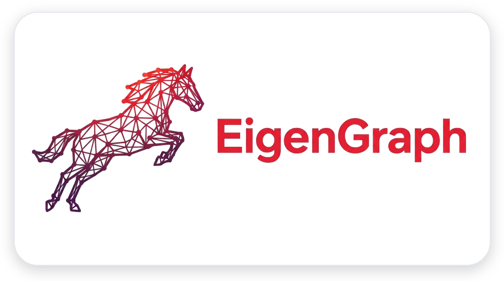

<div align="center">



# EigenGraph — Adjusted Redundancy Index (ARI) & Spatial Structural Analytics

### Doctoral Dissertation Reference Platform (Rust + WebAssembly / 100% Pure WebGPU)

[](https://eigengraph.net/)
[](docs/CHANGELOG.md)
[-orange?style=for-the-badge&logo=rust&logoColor=white)](https://github.com/EigenGraph/EigenGraph)
[](LICENSE)

[**Launch Interactive Web Workstation ↗**](https://eigengraph.net/) • [**Mirror (`www`) ↗**](https://www.eigengraph.net/)

</div>

---

## Doctoral Dissertation Summary

> **Title**: *Development and Validation of the Adjusted Redundancy Index for Pre-Analysis Screening of Element Damage Scenarios in Linear-Elastic Structures*
>
> **Author**: Harids Irawan

### Research Overview
Exhaustive progressive-collapse and element-disruption assessment across large structural portfolios is computationally intensive—even when accelerated by Graph Neural Network (GNN) surrogates. This dissertation introduces and validates the **Adjusted Redundancy Index (ARI)** and **Criticality Index (CI)** as a mechanics-informed, intact-model pre-analysis screening framework for linear-elastic structures.

Rather than relying on purely topological graph metrics, **ARI** combines stiffness- and capacity-weighted alternative load paths (deterministic edge-disjoint path aggregation) with initial utilization adjustments and a **three-channel formulation (`ARI v2`)** integrating kinematic stiffness reserve, cross-section capacity, and deformation control with convex weights $(w_k, w_c, w_d) = (0.25, 0.45, 0.30)$.

### Key Validated Findings
1. **Mathematical & Algorithmic Verification**: The ARI formulation satisfies canonical boundary axioms and achieved **100% pass rate (342/342 automated verification tests)** across deterministic edge-disjoint path searches and direct-stiffness benchmarks.
2. **Epistemic Boundary of Graph Connectivity**: Canonical counterexamples demonstrated that graph connectivity and low topological `CI` alone do *not* guarantee structural stability—removing a zero-force member can still trigger stiffness-matrix rank deficiency (a kinematic mechanism).
3. **Intact-Model Spectral Kinematic Guard**: Coupling ARI with an intact-model spectral/SVD kinematic guard successfully detected and forwarded **100% of mechanism-inducing disruptions** without distorting the underlying path-scoring formula.
4. **Full-Scale Empirical Screening (`S1–S5`)**: Evaluated on an independent benchmark of **300 parent structural models** across five structural families (**7,640 element loss and degradation scenarios**) under strict conformal risk calibration and frozen blind testing, **`ARI v2`** achieved a **68.4% scenario reduction** while maintaining **100.0% safety recall** on all critical collapse scenarios.
5. **Pairwise ARI–GNN Integration & Green AI**: Deploying `ARI v2` as a pre-analysis filter ahead of a trained surrogate Graph Neural Network (**`StructGNN-CRC v1.0`**) reduced net wall-clock computation time by **64.8%** compared to exhaustive GNN inference, substantially lowering computational energy demand and carbon emissions.

**Keywords**: *Adjusted Redundancy Index (ARI)*, *Alternative Load Paths*, *Spectral Kinematic Guard*, *Progressive Collapse Screening*, *Graph Neural Networks (`StructGNN-CRC`)*, *Green AI*, *Structural Redundancy*.

---

## EigenGraph Computational Platform (`v0.8.0`)

**EigenGraph** operationalizes the dissertation's ARI & Spectral Kinematic Guard engines inside a **100% Pure-Rust • 100% Vector • 100% Pure WebGPU (`wgpu` + WGSL + `@compute`) • 100% IFCX (IFC 5 JSON ECS) • 0% WebGL • 0% External Raster** WebAssembly spatial engineering platform deployed to [eigengraph.net](https://eigengraph.net/) (requiring a WebGPU-enabled browser such as Chrome/Edge 113+, Safari 26+, or Firefox 141+ over HTTPS):

- **ARI v2 + StructGNN-CRC Conformal Screening, Collaborative IFCX Governance, WebGPU `@compute` FEMA P-58 Monte Carlo & 3D District Risk Field Heatmap, Tri-Directional PEER `.at2`/`.csv` Replay, Live WebSocket SHM Watchdog, ATC-20 Placard Triage & Autonomous Evacuation Lifelines Core** ([src/core/ari.rs](src/core/ari.rs), [src/core/ifcx_collab.rs](src/core/ifcx_collab.rs), [src/core/cascade.rs](src/core/cascade.rs), [src/core/time_history.rs](src/core/time_history.rs), [src/core/fema_p58.rs](src/core/fema_p58.rs), [src/core/gpu_fragility_mc.rs](src/core/gpu_fragility_mc.rs), [src/core/ground_motion_replay.rs](src/core/ground_motion_replay.rs), [src/core/shm_twin.rs](src/core/shm_twin.rs), [src/core/shm_watchdog.rs](src/core/shm_watchdog.rs), [src/core/evacuation_routing.rs](src/core/evacuation_routing.rs), [src/core/retrofit.rs](src/core/retrofit.rs), [src/core/portfolio_retrofit.rs](src/core/portfolio_retrofit.rs)): Fast $O(N^2)$ Sherman-Morrison linear ARI, rank-2 Woodbury $N-2$ disruption screening, SVD spectral kinematic guard, Two-Stage `ARI v2 + StructGNN-CRC` conformal screening ($\alpha=0.05$) + UFC 4-023-03 DAF-driven progressive collapse cascade (`eigengraph::analysis::crc_cascade`), **SHA-256 tamper-proof multi-discipline IFCX checkpoint chains, formal `Approved` sign-off (`eigengraph::governance::checkpoint_seal`), deterministic 3-Way Peer IFCX Merge with conflict resolver, signed `.ifcx-bundle.json` team handover packages, and IDW 3D Pure WebGPU iso-contour District Risk Field Heatmaps (`Composite` / `PML-90` / `ARI` / `Isolation`)**, **non-blocking Native Multi-Thread / Browser Blob WebWorker `StructGNN-CRC` + 60 FPS tri-directional (`1D X` / `2D XY` / `3D XYZ`) PEER NGA `.at2` / `.csv` earthquake ground-motion replay** (`eigengraph::analysis::time_history_replay`) with 5%-damped SNI 1726 `Match Sa(T1)` scaling, pulsing 3D ASCE 41-17 plastic hinge beacons, **WebGPU `@compute` WGSL FEMA P-58 Monte Carlo probabilistic fragility (`256–16,384` realizations yielding P10/P50/PML-90/CVaR-95 & REDi™ tier probabilities, `eigengraph::analysis::gpu_monte_carlo_loss`) & 60 FPS GPU multi-hazard seismic wavefield + Venturi wind obstacle particles**, **Live Structural Health Monitoring (SHM) Digital Twin (`eigengraph::analysis::shm_digital_twin`) & Live WebSocket Rolling STA/LTA Anomaly Watchdog (`eigengraph::analysis::shm_watchdog`) with real-time `ws://`/`wss://` streaming, 6-DOF/MDOF modal frequency shift & MAC fingerprint identification, Welch PSD plots, and closed-loop Automated Post-Earthquake ATC-20 Green/Yellow/Red Placard → A\* Evacuation Rerouting (`eigengraph::analysis::atc20_placard`, `eigengraph::analysis::evacuation_lifelines`)**, live $N-1$ member removal, automated single-building structural retrofit (`eigengraph::bim::retrofit_delta`), and autonomous **District Portfolio Retrofit Pareto Optimizer** (`eigengraph::portfolio::retrofit_plan`).
- **Site-Coupled 6-DOF FEM, Subsurface Stratigraphy, Winkler SSI & District Multi-Hazard Engine** ([src/core/solver.rs](src/core/solver.rs), [src/core/modal.rs](src/core/modal.rs), [src/core/geotech.rs](src/core/geotech.rs), [src/core/gis/district_hazard.rs](src/core/gis/district_hazard.rs)): 6-DOF 3D frame solver with coupled elastic 6-DOF foundation Winkler springs (`[kx, ky, kz, krx, kry, krz]`), multi-horizon 3D subsurface borehole stratigraphy (`Vs30`, $N_{\text{SPT}}$, Seed–Idriss cyclic liquefaction screening with $p$-$y$ degradation), Veletsos–Meek SSI period lengthening (`T -> T̃`), SNI 1726 / ASCE 7 traveling seismic waves, phase-lag inter-building pounding, Venturi urban wind streamlines, 3D TIN flood inundation, and GPU-animated 3D modal eigenmodes (`Mode 1–3`).
- **Modular 100% Pure-Rust IFCX (IFC 5) Living Earth, Multi-Layer Visual Diffing & Pure-Vector Dossier Exporter** ([src/core/ifcx.rs](src/core/ifcx.rs), [src/core/vector_dossier.rs](src/core/vector_dossier.rs), [src/core/gis/city_builder.rs](src/core/gis/city_builder.rs), [src/views/webgpu_earth/mod.rs](src/views/webgpu_earth/mod.rs), [src/views/universal_canvas/mod.rs](src/views/universal_canvas/mod.rs), [src/views/spatial_workspace/mod.rs](src/views/spatial_workspace/mod.rs)): Composable JSON ECS scene graph (`earth_globe.ifcx` + georeferenced sites + `IfcRoad` / `IfcBridge` / `IfcSpatialZone` / `IfcSite` auto-graded pads + non-destructive FEMA P-58 fragility, portfolio retrofit, subsurface SSI, building retrofit, CRC cascade & `eigengraph::ifcx::diff_manifest` overlays + A3 Pure-Vector SVG engineering dossiers with SHA-256 verification seals + streaming AI real-building capture) streaming `usd::usdgeom::mesh`, active 3D BIM/FEM/Modal/N-1/Retrofit/Cascade/Diff meshes, 3D district retrofit crowns, 3D FEMA P-58 story-loss halos, and 3D subsurface soil strata into a **100% Pure WebGPU (`egui-wgpu` + `wgpu` WGSL)** 24-bit Z-buffered pipeline with zero WebGL/GLSL dependencies, operated strictly through one dynamically widening Liquid Glass Dynamic Island (0% legacy STEP IFC, 0% raster pixels).

---

## Local Development & Verification

```bash
# Add WebAssembly target and Trunk bundler
rustup target add wasm32-unknown-unknown
cargo install --locked trunk

# Run locally with hot reload
trunk serve --public-url / --open

# Verify Rust tests & WebAssembly compilation
cargo test --lib
cargo check --bin eigengraph --target wasm32-unknown-unknown
trunk build --release --public-url /
```

---

## Documentation & Citation

- [Changelog (`v0.0.1` – `v0.8.0`)](docs/CHANGELOG.md)
- [IFCX Earth Architecture Roadmap](docs/IFCX%20Earth.md)
- [Spatial UI Architecture Contract](docs/UI_ARCHITECTURE.md)
- [Repository Guidelines](AGENTS.md)

If you reference the **Adjusted Redundancy Index (ARI)** methodology or EigenGraph platform in academic work, please cite:

> Irawan, H. (2026). *Development and Validation of the Adjusted Redundancy Index for Pre-Analysis Screening of Element Damage Scenarios in Linear-Elastic Structures*

---

## License

Copyright © 2026 Harids Irawan.
Dual-licensed under the [MIT License](LICENSE) and [Apache License 2.0](LICENSE).
