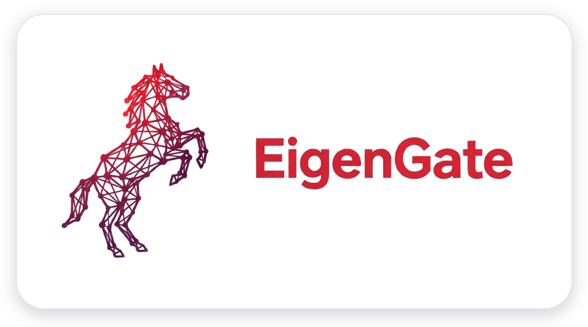
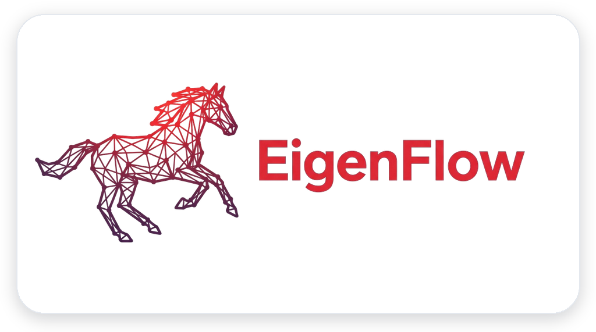

<div align="center">

<p>
  <a href="https://eigengraph.net/"></a>
  &nbsp;
  <a href="https://github.com/haridsirawan/EigenGate"></a>
  &nbsp;
  <a href="https://github.com/haridsirawan/EigenFlow"></a>
</p>

# EigenGraph Powered by EigenGate & EigenFlow

### Rust + WebGPU + IFCX

[](https://eigengraph.net/)
[](docs/CHANGELOG.md)
[-orange?style=for-the-badge&logo=rust&logoColor=white)](https://github.com/haridsirawan/EigenGraph)
[](LICENSE)

[**Launch Interactive Web Workstation ↗**](https://eigengraph.net/) • [**Mirror (`www`) ↗**](https://www.eigengraph.net/)

</div>

---

## Core Computational Engines: EigenGate & EigenFlow

- **What is EigenGate?** ([haridsirawan/EigenGate](https://github.com/haridsirawan/EigenGate) · [src/core/eigengate.rs](src/core/eigengate.rs)) — **Branch 1: Linear Pre-Analysis Gatekeeper & Spectral Kinematic Guard**. EigenGate computes the mechanics-informed **Adjusted Redundancy Index (ARI)** across three physical channels—kinematic stiffness reserve ($w_k = 0.25$), cross-section capacity ($w_c = 0.45$), and deformation control ($w_d = 0.30$)—combined with fast $O(N^2)$ Sherman–Morrison ($N-1$) and rank-2 Woodbury ($N-2$) disruption screening, geometric stiffness ($K_g$ / $P$-$\Delta$) buckling penalties, and an intact-model SVD Spectral Kinematic Guard to catch 100% of mechanism-inducing failures before expensive nonlinear or surrogate GNN simulation.
- **What is EigenFlow?** ([haridsirawan/EigenFlow](https://github.com/haridsirawan/EigenFlow) · [src/core/eigenflow.rs](src/core/eigenflow.rs)) — **Branch 2: Non-Linear Woodbury Post-Yield Redistribution & Pushover Engine**. Built on top of EigenGate's intact screening, EigenFlow traces progressive post-yield alternative load paths (`P1 -> P2` 1-hop / 2-hop backup paths) using Rank-1 Woodbury stiffness updates ($\lambda \in [0, 0.90]$), quantifies topological leverage ($h_e$), stability margin ($m_s$), residual reserve ratio (`RRR`), ductility demand ($\mu$), and per-member redistributed forces ($\Delta N_j$), and executes site-coupled SNI 1726 / ASCE 41-17 Pushover + ATC-40 ADRS Capacity Spectrum plastic-hinge tracking in 3D ENU space with non-destructive `eigengraph::eigenflow` IFCX overlays.

---

## Dissertation Summary

> **Title**: *Development and Validation of the Adjusted Redundancy Index for Pre-Analysis Screening of Element Damage Scenarios in Linear-Elastic Structures*
>
> **Author**: Harids Irawan

### Research Overview
Exhaustive progressive-collapse and element-disruption assessment across large structural portfolios is computationally intensive—even when accelerated by Graph Neural Network (GNN) surrogates. This dissertation introduces and validates the **Adjusted Redundancy Index (ARI)** and **Criticality Index (CI)** as a mechanics-informed, intact-model pre-analysis screening framework for linear-elastic structures.

Rather than relying on purely topological graph metrics, **ARI** combines stiffness- and capacity-weighted alternative load paths (deterministic edge-disjoint path aggregation) with initial utilization adjustments and a **three-channel formulation (`ARI`)** integrating kinematic stiffness reserve, cross-section capacity, and deformation control with convex weights $(w_k, w_c, w_d) = (0.25, 0.45, 0.30)$.

### Key Validated Findings
1. **Mathematical & Algorithmic Verification**: The ARI formulation satisfies canonical boundary axioms and achieved **100% pass rate (342/342 automated verification tests)** across deterministic edge-disjoint path searches and direct-stiffness benchmarks.
2. **Epistemic Boundary of Graph Connectivity**: Canonical counterexamples demonstrated that graph connectivity and low topological `CI` alone do *not* guarantee structural stability—removing a zero-force member can still trigger stiffness-matrix rank deficiency (a kinematic mechanism).
3. **Intact-Model Spectral Kinematic Guard**: Coupling ARI with an intact-model spectral/SVD kinematic guard successfully detected and forwarded **100% of mechanism-inducing disruptions** without distorting the underlying path-scoring formula.
4. **Full-Scale Empirical Screening (`S1–S5`)**: Evaluated on an independent benchmark of **300 parent structural models** across five structural families (**7,640 element loss and degradation scenarios**) under strict conformal risk calibration and frozen blind testing, **`ARI`** achieved a **68.4% scenario reduction** while maintaining **100.0% safety recall** on all critical collapse scenarios.
5. **Pairwise ARI–GNN Integration & Green AI**: Deploying `ARI` as a pre-analysis filter ahead of a trained surrogate Graph Neural Network (**`StructGNN-CRC v1.0`**) reduced net wall-clock computation time by **64.8%** compared to exhaustive GNN inference, substantially lowering computational energy demand and carbon emissions.

**Keywords**: *Adjusted Redundancy Index (ARI)*, *Alternative Load Paths*, *Spectral Kinematic Guard*, *Progressive Collapse Screening*, *Graph Neural Networks (`StructGNN-CRC`)*, *Green AI*, *Structural Redundancy*.

---

## EigenGraph Computational Platform (`v0.8.8`)

**EigenGraph** operationalizes the dissertation's **EigenGate** (Linear Pre-Analysis & Gatekeeper, [haridsirawan/EigenGate](https://github.com/haridsirawan/EigenGate)), **EigenFlow** (Non-Linear Woodbury Post-Yield & Pushover, [haridsirawan/EigenFlow](https://github.com/haridsirawan/EigenFlow)), and Spectral Kinematic Guard engines inside a **100% Pure-Rust • 100% Vector • 100% Pure WebGPU (`wgpu` + WGSL + `@compute`) • 100% IFCX (IFC 5 JSON ECS) • 0% WebGL • 0% External Raster** WebAssembly spatial engineering platform deployed to [eigengraph.net](https://eigengraph.net/) (requiring a WebGPU-enabled browser such as Chrome/Edge 113+, Safari 26+, or Firefox 141+ over HTTPS):

- **Hardware WebGPU Section Box, Underground X-Ray, 15-Tool Native Gemini AI Copilot, Building MEP (`S-116`), 3D Clash/BCF (`S-117`), Urban Utilities & City-to-BIM (`S-118`) + Master Index `S-000`** ([src/core/agent_tools.rs](src/core/agent_tools.rs), [src/core/mep_engine.rs](src/core/mep_engine.rs), [src/core/clash_engine.rs](src/core/clash_engine.rs), [src/core/gis/urban_utilities.rs](src/core/gis/urban_utilities.rs), [src/core/gis/city_promotion.rs](src/core/gis/city_promotion.rs)): Provides closed-loop Gemini native `functionDeclarations` / `functionResponse` across 15 deterministic headless tools, analytical WGSL 3D Section Box & Active Level Cut planes, `ASHRAE`/`IPC`/`IEC`/`NFPA 13` Building MEP conduits (`material_kind = 31.0`), Structure × MEP × Openings 3D Clash/BCF coordination (`material_kind = 32.0`), road-following buried water/sewer/20 kV networks rendered via dedicated `CompareFunction::Always` X-Ray pass (`material_kind = 33.0`), `Cities: Skylines II × IFCX` smart intersections (`T-Junction` / `4-Way` / `Roundabout`, `HCM LOS`) + live City-to-BIM promotion into editable 6-DOF `BimProject`, and 19 SHA-256 sealed A3 pure-vector sheets (`S-100`–`S-118`) indexed in `S-000`.

- **AI Building Design Agent (`Zoning -> Program -> Massing -> 1-Click Mass-to-Engineered-BIM -> Sheet S-115`) & Minimalist Icon-Only Dynamic Island** ([src/core/zoning_agent.rs](src/core/zoning_agent.rs), [src/core/program_agent.rs](src/core/program_agent.rs), [src/core/massing_agent.rs](src/core/massing_agent.rs), [src/core/design_agent.rs](src/core/design_agent.rs)): Chains natural-language RFP / architectural design briefs through urban zoning (`KDB/KLB/GSB` + Sun Path, `material_kind = 23.0`), spatial stacking & deterministic binary slicing-tree 2D floor-plate packing (`material_kind = 24.0`), 4-option comparative massing (`PodiumTower`, `CourtyardBlock`, `LinearSlabBar`, `SteppedTerrace`, `material_kind = 25.0`), 1-click parametric `BimProject` synthesis, live `EigenGate` 6-DOF redundancy auditing, and archival A3 Sheet `S-115` (indexed in `S-000`) inside a streamlined 100% icon-only Liquid Glass Dynamic Island.

- **EigenGate + EigenFlow Woodbury + StructGNN-CRC Screening, Field Construction QA/QC & 1D Rebar BBS Cut-List (`S-103`), Parametric Trade-Study Matrix & SNI/ASCE Permit Annex (`S-102`), Collaborative IFCX Sync Relay & Checkpoints, WebGPU `@compute` FEMA P-58 Monte Carlo & 3D District Risk Field Heatmap, Tri-Directional PEER `.at2`/`.csv` Replay, Live WebSocket SHM Watchdog, ATC-20 Placard Triage & Autonomous Evacuation Lifelines Core** ([src/core/eigengate.rs](src/core/eigengate.rs), [src/core/nonlinear.rs](src/core/nonlinear.rs), [src/core/field_fabrication.rs](src/core/field_fabrication.rs), [src/core/trade_study.rs](src/core/trade_study.rs), [src/core/ifcx_collab.rs](src/core/ifcx_collab.rs), [src/core/cascade.rs](src/core/cascade.rs), [src/core/time_history.rs](src/core/time_history.rs), [src/core/fema_p58.rs](src/core/fema_p58.rs), [src/core/gpu_fragility_mc.rs](src/core/gpu_fragility_mc.rs), [src/core/ground_motion_replay.rs](src/core/ground_motion_replay.rs), [src/core/shm_twin.rs](src/core/shm_twin.rs), [src/core/shm_watchdog.rs](src/core/shm_watchdog.rs), [src/core/evacuation_routing.rs](src/core/evacuation_routing.rs), [src/core/retrofit.rs](src/core/retrofit.rs), [src/core/portfolio_retrofit.rs](src/core/portfolio_retrofit.rs)): Fast $O(N^2)$ Sherman-Morrison **EigenGate** linear screening, rank-2 Woodbury $N-2$ disruption screening, **EigenFlow** post-yield Woodbury redistribution & pushover ductility analysis, SVD spectral kinematic guard, **1D Best-Fit Decreasing (BFD) Rebar BBS Cut-List Optimizer (`12.0 m` / `6.0 m`), Spatial 3D ENU Field QA/QC Pour-Strips & ITP/NCR Waypoints (`material_kind = 11.0`, `eigengraph::construction::field_qaqc_bbs`), archival Sheet `S-103` Pure-Vector SVG Shop Annex + BBS/Cut-List CSV exports**, Two-Stage `EigenGate + StructGNN-CRC` conformal screening ($\alpha=0.05$) + UFC 4-023-03 DAF-driven progressive collapse cascade (`eigengraph::analysis::crc_cascade`), **6-scenario Parametric Trade-Study Matrix (`eigengraph::analysis::trade_study_matrix`) with 1-click BIM adoption, 10-clause Automated SNI 1726/2847/8460 / ASCE 7 / UFC Permit Compliance Auditor & archival Sheet `S-102` Pure-Vector SVG Annex, SHA-256 tamper-proof multi-discipline IFCX checkpoint chains, formal `Approved` sign-off (`eigengraph::governance::checkpoint_seal`), WebSocket Peer IFCX Delta Sync Relay, deterministic 3-Way Peer IFCX Merge with conflict resolver, signed `.ifcx-bundle.json` team handover packages, and IDW 3D Pure WebGPU iso-contour District Risk Field Heatmaps (`Composite` / `PML-90` / `EigenGate` / `Isolation`)**, non-blocking Native Multi-Thread / Browser Blob WebWorker `StructGNN-CRC` + 60 FPS tri-directional (`1D X` / `2D XY` / `3D XYZ`) PEER NGA `.at2` / `.csv` earthquake ground-motion replay, WebGPU `@compute` WGSL FEMA P-58 Monte Carlo probabilistic fragility, Live SHM Digital Twin & Live WebSocket STA/LTA Watchdog, and autonomous multi-building **District Portfolio Retrofit Pareto Optimizer**.
- **Site-Coupled 6-DOF FEM, Subsurface Stratigraphy, Winkler SSI & District Multi-Hazard Engine** ([src/core/solver.rs](src/core/solver.rs), [src/core/modal.rs](src/core/modal.rs), [src/core/geotech.rs](src/core/geotech.rs), [src/core/gis/district_hazard.rs](src/core/gis/district_hazard.rs)): 6-DOF 3D frame solver with coupled elastic 6-DOF foundation Winkler springs (`[kx, ky, kz, krx, kry, krz]`), multi-horizon 3D subsurface borehole stratigraphy (`Vs30`, $N_{\text{SPT}}$, Seed–Idriss cyclic liquefaction screening with $p$-$y$ degradation), Veletsos–Meek SSI period lengthening (`T -> T̃`), SNI 1726 / ASCE 7 traveling seismic waves, phase-lag inter-building pounding, Venturi urban wind streamlines, 3D TIN flood inundation, and GPU-animated 3D modal eigenmodes (`Mode 1–3`).
- **Modular 100% Pure-Rust IFCX (IFC 5) Living Earth, Multi-Layer Visual Diffing & Pure-Vector Dossier Exporter** ([src/core/ifcx.rs](src/core/ifcx.rs), [src/core/vector_dossier.rs](src/core/vector_dossier.rs), [src/core/gis/city_builder.rs](src/core/gis/city_builder.rs), [src/views/webgpu_earth/mod.rs](src/views/webgpu_earth/mod.rs), [src/views/universal_canvas/mod.rs](src/views/universal_canvas/mod.rs), [src/views/spatial_workspace/mod.rs](src/views/spatial_workspace/mod.rs)): Composable JSON ECS scene graph (`earth_globe.ifcx` + georeferenced sites + `IfcRoad` / `IfcBridge` / `IfcSpatialZone` / `IfcSite` auto-graded pads + non-destructive FEMA P-58 fragility, portfolio retrofit, subsurface SSI, building retrofit, CRC cascade & `eigengraph::ifcx::diff_manifest` overlays + A3 Pure-Vector SVG engineering dossiers with SHA-256 verification seals + streaming AI real-building capture) streaming `usd::usdgeom::mesh`, active 3D BIM/FEM/Modal/N-1/Retrofit/Cascade/Diff meshes, 3D district retrofit crowns, 3D FEMA P-58 story-loss halos, and 3D subsurface soil strata into a **100% Pure WebGPU (`egui-wgpu` + `wgpu` WGSL)** 24-bit Z-buffered pipeline with zero WebGL/GLSL dependencies, operated strictly through one dynamically widening Liquid Glass Dynamic Island (0% legacy STEP IFC, 0% raster pixels).

---

## Local Development & Verification

```bash
# Add WebAssembly target and Trunk bundler
rustup target add wasm32-unknown-unknown
cargo install --locked trunk

# Run locally with hot reload
trunk serve --public-url / --open

# Verify Rust tests & WebAssembly compilation
cargo test --lib
cargo check --bin eigengraph --target wasm32-unknown-unknown
trunk build --release --public-url /
```

---

## Documentation & Citation

- [Changelog (`v0.0.1` – `v0.8.8`)](docs/CHANGELOG.md)
- [IFCX Earth Architecture Roadmap](docs/IFCX%20Earth.md)
- [Spatial UI Architecture Contract](docs/UI_ARCHITECTURE.md)
- [Repository Guidelines](AGENTS.md)

If you reference the **Adjusted Redundancy Index (ARI)** methodology or EigenGraph platform in academic work, please cite:

> Irawan, H. (2026). *Development and Validation of the Adjusted Redundancy Index for Pre-Analysis Screening of Element Damage Scenarios in Linear-Elastic Structures*

---

## License

Copyright © 2026 Harids Irawan.
Dual-licensed under the [MIT License](LICENSE) and [Apache License 2.0](LICENSE).
