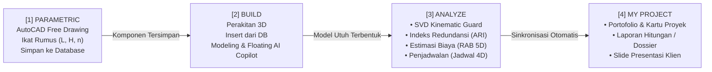

# 🗺️ Master Plan & Rencana Pengembangan: EigenGraph

> **Platform Desktop BIM & Analisis Redundansi Graf Struktural Berbasis Estetika macOS App Store**  
> Peneliti & Pengembang: **Harids Irawan**  
> Fokus Riset: *Adjusted Redundancy Index (ARI), SVD Kinematic Guard, & Pencegahan Keruntuhan Progresif*  
> Target Framework: **Rust (`eframe`, `egui`, `wgpu`) + Metal macOS Native + Gemini AI Copilot**

---

## 🌟 1. Visi & Filosofi Desain

EigenGraph dirancang untuk mendobrak paradigma perangkat lunak teknik sipil dan arsitektur (CAD/BIM) konvensional yang kaku, rumit, dan tertinggal di era 90-an (seperti SAP2000, ETABS, atau Revit). 

EigenGraph menggabungkan:
1. **Human Interface Guidelines (HIG) macOS App Store**: Tampilan berbasis kartu kurasi, navigasi pilar segmented pill, *zero-home portfolio*, dan antarmuka mengambang yang bersih dan modern.
2. **AutoCAD-style Free Drawing Studio**: Fleksibilitas menggambar bebas 2D/3D dengan dimensi parametrik dinamis yang tersimpan ke database komponen.
3. **Floating Dynamic Island AI Copilot (Opsi B)**: Asisten kecerdasan buatan mengambang di bawah kanvas (terinspirasi oleh Google Antigravity & Apple Dynamic Island) yang dapat dipanggil seketika (`⌘K`) tanpa mengorbankan ruang kanvas.
4. **Deep Mechanics Integration**: Langsung mengintegrasikan riset doktoral **Adjusted Redundancy Index (ARI)** dan **SVD Kinematic Guard** untuk mendeteksi mekanisme keruntuhan dini dan memverifikasi jalur beban alternatif (*Alternate Load Path*).
5. **Full BIM Ecosystem (3D, 4D, & 5D)**:
   - **BIM 3D**: Geometri parametrik & perakitan model struktur.
   - **BIM 4D**: Penjadwalan pelaksanaan (*Time Schedule*, WBS, *Gantt Chart*, dan Kurva S).
   - **BIM 5D**: Perhitungan volume (*Quantity Takeoff*) & Rencana Anggaran Biaya (RAB / BOQ).

---

## 🏛️ 2. Struktur 5 Pilar Utama EigenGraph

```
┌────────────────────────────────────────────────────────────────────────────────────────┐
│ 🍏 [MY PROJECT]   [PARAMETRIC]   [BUILD]   [ANALYZE]   [SETTINGS]     🔍 Search...    │
└────────────────────────────────────────────────────────────────────────────────────────┘
```

| Pilar | Peran Utama | Model Tampilan |
| :--- | :--- | :--- |
| **1. 📑 MY PROJECT** | Portofolio, Etalase Laporan, Dossier PDF, & Presentasi Klien | Mac App Store Featured Hero Banner + 3-Column Curated Card Grid |
| **2. 📐 PARAMETRIC** | Studio Menggambar Bebas & Pustaka Database Komponen | AutoCAD Charcoal Canvas + Ribbon Drafting + Parameter Panel + "Save to DB" |
| **3. 🏗️ BUILD** | Perakitan Struktur 3D & Pemodelan Fisik | Kanvas 3D Viewport (`wgpu`) + Sidebar CAD/BIM Murni + Floating Dynamic Island AI Copilot (`⌘K`) |
| **4. ⚡ ANALYZE** | Dapur Kalkulasi Teknis: Redundansi ARI, SVD Guard, RAB, & Jadwal | 3 Sub-Tab: (1) Redundancy & SVD, (2) RAB & Volume Takeoff, (3) Penjadwalan & Kurva S |
| **5. ⚙️ SETTINGS** | Preferensi Sistem, Standar Desain, Toleransi, & API AI | macOS System Preferences Grouped Cards (SNI 1729, AISC 360, SVD $\varepsilon_{tol}$, Gemini API) |

---

## 🔄 3. Alur Kerja Terintegrasi (Core User Journey)



---

## 📅 4. Tahapan Rencana Pengembangan (Roadmap Phases)

---

### 🟢 FASE 0: Pondasi UI/UX & Scaffolding Arsitektur (SELESAI ✅)
*Target: Menyiapkan kerangka kerja utuh 5 pilar dengan standar visual Apple Human Interface Guidelines.*
- [x] Konfigurasi proyek Rust berbasis `eframe`, `egui`, dan `serde`.
- [x] Implementasi Top Navigation Bar dengan segmented pill buttons dan search input.
- [x] Perancangan **MY PROJECT** sebagai homepage portofolio berkonsep Mac App Store (Featured Hero Banner, Filter Kategori, Card Grid).
- [x] Transformasi **PARAMETRIC** menjadi AutoCAD Free Drawing Studio (Ribbon CAD, Snap, Ortho, Variable Panel, Command Line, dan integrasi Save to Database).
- [x] Perancangan **BUILD** dengan kanvas 3D, sidebar kiri murni CAD/BIM (4 tab: Properties, Browser, Modify, Layers), dan **Opsi B Floating Dynamic Island AI Copilot** di bawah kanvas dengan pintasan `⌘K` / `Esc`.
- [x] Pembuatan prototipe dashboard **ANALYZE** (SVD Guard banner, KPI Cards, Member Screening Table).
- [x] Pembuatan panel **SETTINGS** bergaya macOS System Preferences.
- [x] Repositori GitHub resmi dipublikasikan di `haridsirawan/EigenGraph`.

---

### 🟡 FASE 1: Mesin Drafting CAD Bebas & Database Komponen (`PARAMETRIC`)
*Target: Mewujudkan mesin gambar vektor CAD 2D/3D yang presisi dan sistemik.*
1. **Inti Primitif Geometri CAD**:
   - Algoritma penggambaran: Garis (*Line*), Garis Poligon (*Polyline*), Busur (*Arc*), Lingkaran (*Circle*), Kotak (*Rectangle*), dan Titik Nodal (*Node*).
   - Sistem Koordinat WCS (*World Coordinate System*) dan UCS (*User Coordinate System*).
2. **Mesin Snapping & Akurasi**:
   - Grid Snap dinamis (resolusi 100mm, 500mm, 1000mm).
   - *Object Snap* (OSNAP): Titik Ujung (*Endpoint*), Titik Tengah (*Midpoint*), Pusat Lingkaran (*Center*), Perpotongan (*Intersection*), dan Tegak Lurus (*Perpendicular*).
   - Mode Ortho (penguncian sumbu horizontal & vertikal via shortcut `F8` / `Shift`).
3. **Geometric Constraints & Parametric Driving Dimensions**:
   - Fitur dimensi penggerak (*driving dimensions*): mengubah nilai $L = 24000\text{ mm}$ otomatis memperpanjang geometri gambar secara proporsional.
   - Formula ekspresi matematis: Parser formula string (contoh: $H = L / 7.5$, $n = \text{ceil}(L / 4000)$).
4. **Sistem Database Komponen Lokal**:
   - Skema penyimpanan SQLite / JSON terenkripsi untuk menyimpan komponen hasil gambar.
   - Metadata komponen: Nama, Tipe Geometri, Variabel Input, Estimasi Jumlah Batang, dan Thumbnail Vektor.

---

### 🟠 FASE 2: Perakitan Struktur 3D & Kanvas Modeling (`BUILD`)
*Target: Menghubungkan komponen dari database ke ruang 3D kanvas dan interaktivitas AI.*
1. **Engine Grafis 3D Hardware Accelerated**:
   - Integrasi `wgpu` (Metal pada macOS, Vulkan pada Linux/Windows).
   - Sistem kamera 3D: Orbit (*Right-Click Drag*), Pan (*Middle-Click*), Zoom (*Scroll Wheel*), dan *ViewCube* (Top, Front, Side, Isometric).
2. **Import & Instansiasi Komponen Database**:
   - Panel Browser menampilkan daftar komponen dari database `PARAMETRIC`.
   - Aksi *Drag-and-Drop* atau tombol `[+ Insert]` untuk menempatkan komponen ke titik koordinat tertentu di ruang 3D.
   - Array & Duplikasi parametrik (contoh: mengulang bentang truss setiap jarak 6 meter sebanyak 10 bay).
3. **Struktur Data Graf Elemen Nodal**:
   - Struktur data berbasis Graf: *Nodes* (koordinat $X, Y, Z$, kondisi tumpuan/restraint) dan *Elements* (panjang, orientasi sudut roll, properti penampang, material baja).
   - Sistem layer visibilitas (*Ground Grid, Axes, Wireframe, Node IDs, Heatmap, Deformed Mesh*).
4. **Integrasi Nyata Floating Dynamic Island AI Copilot**:
   - Koneksi ke Google Gemini 2.5 Flash API melalui *Function Calling*.
   - Perintah bahasa alami yang dapat dieksekusi langsung ke kanvas model (contoh: *"Buatkan space truss bentang 30 meter dengan modul 3 meter"*, *"Tampilkan elemen dengan pembebanan tarik tertinggi"*).

---

### 🔴 FASE 3: Mesin Mekanika Rekayasa, SVD Kinematic Guard, & ARI (`ANALYZE`)
*Target: Implementasi inti solver mekanika struktur dan riset doktoral Adjusted Redundancy Index.*
1. **Solver Metode Kekakuan Langsung (Direct Stiffness Method - DSM)**:
   - Pembentukan matriks kekakuan elemen lokal $[k_e]$ (elemen truss 3D & frame 3D 6-DOF per node).
   - Transformasi koordinat global $[T]^T [k_e] [T]$ dan perakitan matriks kekakuan global $[K]$.
   - Penyelesaian persamaan keseimbangan $[K] \{D\} = \{P\}$ menggunakan *sparse linear algebra* (`nalgebra-sparse` atau `faer`).
2. **SVD Kinematic Stability Guard (Deteksi Mekanisme Keruntuhan)**:
   - Dekomposisi Nilai Singular (*Singular Value Decomposition*):
     $$[K] = [U] [\Sigma] [V]^T$$
   - Pemeriksaan kondisi rank: Memastikan $\text{rank}(K) = n_{dof} - n_{rigid}$.
   - Deteksi nilai singular mendekati nol ($\sigma_i < \varepsilon_{tol}$): Mengidentifikasi moda gerakan mekanisme tak stabil sebelum analisis gagal / meledak (*crash*).
3. **Kalkulasi Adjusted Redundancy Index (ARI)**:
   - Perhitungan matriks kontribusi redundansi elemen $R_{ij}$.
   - Penentuan indeks redundansi tiap batang $\text{ARI}_i$.
   - Simulasi *Alternate Load Path Method* (ALPM): Melepas elemen kritis secara virtual dan menghitung redistribusi gaya ke elemen tetangga.
4. **Desain Penampang Baja Sesuai SNI 1729 / AISC 360-16 LRFD**:
   - Pemeriksaan kapasitas tarik aksial ($\phi_t P_n$) dan tekan tekuk Euler ($\phi_c P_n$).
   - Pemeriksaan kapasitas lentur ($\phi_b M_n$) dengan memperhitungkan *Lateral Torsional Buckling* (LTB).
   - Evaluasi rasio interaksi aksial-lentur $\frac{P_u}{\phi P_n} + \frac{8}{9}\frac{M_u}{\phi M_n} \le 1.0$.

---

### 🟣 FASE 4: Estimasi Biaya Proyek & Volume Takeoff (BIM 5D di `ANALYZE`)
*Target: Menghitung anggaran biaya konstruksi secara presisi dari model 3D.*
1. **Automatic Quantity Takeoff (QTO)**:
   - Ekstraksi otomatis panjang total setiap profil penampang (misal: total panjang W14x90 = 480 meter).
   - Konversi berat total baja dalam satuan Kilogram dan Ton ($\text{Volume} \times \text{Density Baja } 7850\text{ kg/m}^3$).
   - Estimasi luas permukaan baja untuk perhitungan cat dasar anti karat dan cat proteksi api (*fireproofing* dalam $m^2$).
   - Estimasi volume beton untuk pedestal tumpuan dan pondasi ($m^3$).
2. **Modul Rencana Anggaran Biaya (RAB / BOQ)**:
   - Database Analisa Harga Satuan Pekerjaan (AHSP):
     - Biaya pengadaan material baja (Rp/kg).
     - Biaya fabrikasi workshop (pemotongan, *welding*, pelat buhul).
     - Biaya transportasi ke lokasi proyek.
     - Biaya *erection* menggunakan mobile crane di lapangan (Rp/ton atau Rp/hari).
   - Tabel rekapitulasi Rencana Anggaran Biaya (RAB) lengkap dengan PPN, *overhead*, dan *contingency fee*.
3. **Analisis Sensitivitas Biaya vs. Redundansi (Cost vs. ARI Trade-Off)**:
   - Fitur riset eksklusif: Kurva korelasi antara penambahan biaya material/penampang terhadap peningkatan indeks redundansi global $\overline{\text{ARI}}$.
   - Membantu *decision maker* menentukan titik optimum antara efisiensi anggaran dan ketahanan terhadap keruntuhan progresif.

---

### 🔵 FASE 5: Penjadwalan Konstruksi & Sequence Erection (BIM 4D di `ANALYZE`)
*Target: Menghitung alokasi waktu pelaksanaan dan kurva S perakitan struktur.*
1. **Work Breakdown Structure (WBS) Otomatis**:
   - Pengelompokan elemen struktur ke dalam fase konstruksi:
     - Tahap 1: Pekerjaan Pondasi & Angkur Tumpuan.
     - Tahap 2: Perakitan Kolom & Rangka Utama (*Main Frame Erection*).
     - Tahap 3: Pemasangan Ikatan Angin & Bracing (*Bracing System*).
     - Tahap 4: Penggantung Kabel / Hangers & Pelat Lantai.
2. **Kalkulasi Durasi Berbasis Produktivitas**:
   - Estimasi kecepatan pemasangan berdasarkan kapasitas crane dan kapasitas tim pekerja (misal: 4 ton baja / hari kerja).
   - Perhitungan total hari kerja kalender dan lintasan kritis (*Critical Path Method - CPM*).
3. **Gantt Chart & Kurva S Proyek**:
   - Visualisasi jadwal berbentuk diagram balok (*Gantt Chart* interaktif).
   - Kurva S progres rencana kumulatif mingguan/bulanan.
4. **Pengecekan Stabilitas Sementara Saat Erection (Staged Construction Analysis)**:
   - Pengecekan stabilitas SVD pada setiap tahapan perakitan untuk memastikan struktur tidak roboh sebelum seluruh sistem pengaku terpasang lengkap.

---

### ⚪ FASE 6: Etalase Proyek, Dossier PDF, & Presentasi Klien (`MY PROJECT`)
*Target: Menyajikan hasil akhir teknis menjadi portofolio dan dokumen kelaikan resmi.*
1. **Laporan Perhitungan Lengkap (Engineering Calculation Dossier)**:
   - Generator laporan resmi dalam format PDF / Markdown / HTML.
   - Berisi lembar hitungan transparan step-by-step:
     - Bab 1: Data Teknis Proyek & Kriteria Desain.
     - Bab 2: Pemodelan Geometri & Rangkaian Parameter Komponen.
     - Bab 3: Kombinasi Pembebanan & Hasil Analisis Gaya Dalam.
     - Bab 4: Evaluasi Desain Kapasitas Penampang Baja SNI/AISC.
     - Bab 5: Sertifikat Stabilitas SVD Guard & Indeks Redundansi ARI.
     - Bab 6: Rencana Anggaran Biaya (RAB / Bill of Quantities).
     - Bab 7: Jadwal Pelaksanaan (Time Schedule & Kurva S).
2. **Modul Presentasi Klien (Executive Client Deck)**:
   - Mode layar penuh (*Presentation Deck*) untuk rapat bersama *Owner* atau Klien.
   - Tampilan interaktif 3D yang dapat diputar secara langsung, disertai ringkasan nilai investasi (RAB), jadwal penyelesaian, dan jaminan keamanan struktur bebas dari keruntuhan progresif.
3. **Manajemen Portofolio Proyek**:
   - Penyimpanan riwayat versi desain.
   - Status sertifikasi kelaikan proyek (*Verified Safe*, *Review Needed*, *Mechanism Warning*).

---

### 🌐 FASE 7: Interoperabilitas BIM, Sinkronisasi Cloud, & Packaging Rilis
*Target: Integrasi industri dan distribusi aplikasi.*
1. **Interoperabilitas Format Industri**:
   - Export & Import format netral BIM: IFC (IFC4/IFC5) dan DXF/DWG 2D/3D.
   - Export model analitis ke SAP2000 (`.s2k`), ETABS (`.$et`), dan format CSV/JSON.
2. **Pengemasan Native macOS**:
   - Kompilasi biner release dengan optimasi LTO (*Link-Time Optimization*) dan *Binary Stripping*.
   - Paket instalasi macOS (`.dmg`) dengan ikon aplikasi kustom dan notarization Apple Developer.
3. **Integrasi Layanan Cloud & Kolaborasi**:
   - Opsi sinkronisasi penyimpanan cloud (Google Drive, iCloud, atau GitHub).
   - Kemampuan berbagi portofolio proyek antar tim melalui web link pratinjau interaktif.

---

### 🟣 FASE 8: Simulasi Kolaps Dinamis & Runtuh Kaskade (Progressive Collapse Engine) (SELESAI ✅)
*Target: Pemodelan keruntuhan berantai (domino effect) pasca disrupsi mendadak sesuai standar DoD UFC 4-023-03 dan ASCE 7-22 Alternate Path Method.*
1. **Dynamic Amplification Factor ($DAF$)**:
   - Pembebanan gravitasi dinamis yang diamplifikasi seketika ($DAF = 1.05 \sim 2.00\times$) pada nodal-nodal terdampak langsung *member loss*.
2. **Iterative Domino Equilibrium Solver**:
   - Simulasi langkah-demi-langkah perambatan leleh/putus batang dengan kriteria rasio permintaan terhadap kapasitas ($DCR > 1.0$).
   - Pendeteksian mekanisme kinematis runtuh total ($\text{dim}(\text{Null}(K)) > 0$) versus penghentian runtuh parsial (*arrested equilibrium*).
3. **Indikator Ketahanan Sistem (PVI & $R_{\text{sys}}$)**:
   - *Propagation Vulnerability Index* ($PVI$): Rasio keruntuhan sekunder terhadap elemen tersisa.
   - *System Robustness Index* ($R_{\text{sys}} = 1.0 - PVI$): Indeks ketahanan global terhadap bencana progresif.

## 📊 Matriks Ringkasan Roadmap & Milestone

| Fase | Fokus Modul | Luaran Utama | Status |
| :---: | :--- | :--- | :---: |
| **Fase 0** | **UI/UX Skeleton & HIG** | 5 Pilar Navigasi, Floating AI Pill (`⌘K`), Card Grid Portofolio | **SELESAI ✅** |
| **Fase 1** | **PARAMETRIC Studio** | AutoCAD Free Drawing 2D/3D, Driving Dimensions, Warren Generator | **SELESAI ✅** |
| **Fase 2** | **BUILD Canvas 3D** | Viewport 3D Orbit, ViewCube Presets (Iso/Top/Front/Side), AI Gemini | **SELESAI ✅** |
| **Fase 3** | **ANALYZE: Redundancy** | Solver DSM, SVD Kinematic Guard, Hyperbolic ARI, AI Bracing Optimizer | **SELESAI ✅** |
| **Fase 4** | **ANALYZE: Biaya (BIM 5D)**| Automatic Volume Takeoff, AHSP PUPR, BOQ 6-Division, RAB Engine | **SELESAI ✅** |
| **Fase 5** | **ANALYZE: Waktu (BIM 4D)** | WBS Perakitan, Gantt Chart, Kurva S, Pengecekan Stabilitas Erection | Tahap Perencanaan |
| **Fase 6** | **MY PROJECT Delivery** | Generator Dossier Resmi Markdown, Executive Deck, Portofolio | **SELESAI ✅** |
| **Fase 7** | **Interoperabilitas & Rilis** | Export OpenBIM IFC 4.3 (Pset_StructuralRedundancy), DXF 3D, SAP2000 | **SELESAI ✅** |
| **Fase 8** | **Kolaps Kaskade & Progresif** | DoD UFC 4-023-03 Alternate Path, DAF 1.25x, PVI, Robustness $R_{\text{sys}}$ | **SELESAI ✅** |

---

*Dokumen rencana pengembangan ini diselaraskan dengan standar riset doktoral dan visi masa depan industri konstruksi digital (AEC).*
