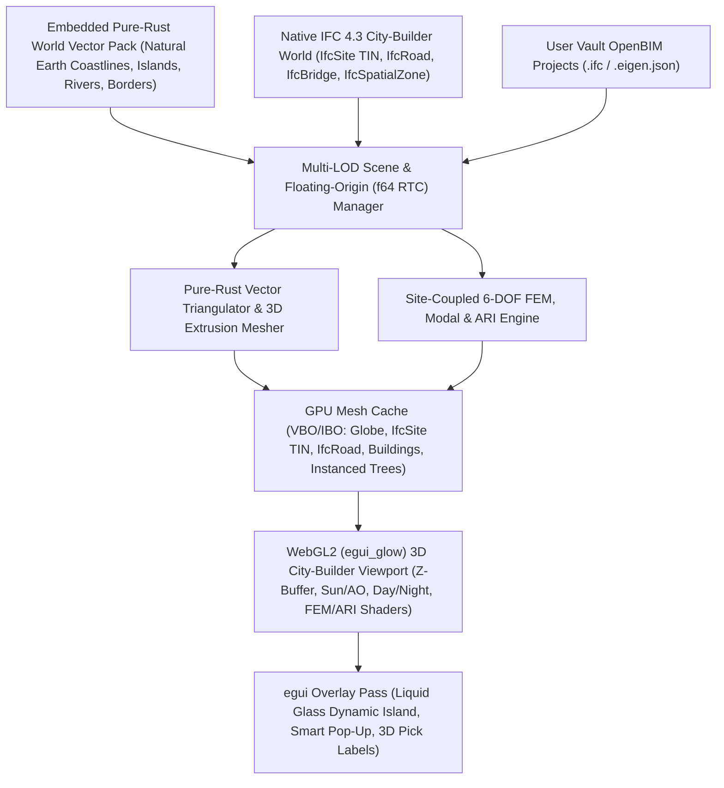

# EigenGraph Earth Vector — 100% Pure-Rust Vector & OpenBIM IFC City-Builder Structural Simulator

> **Status**: Active Roadmap — **Phase 64 (`v0.6.4`) & Phase 65 (`v0.6.5`) Implemented**; Phases 66–67 Planned  
> **Selected Direction**: **100% Pure-Rust Vector + OpenBIM IFC (`IFC4` / `IFC4.3`)** — Zero Raster Tiles, Zero `image` Crate, Zero OSM/Overpass, Zero AWS DEM PNGs, Zero External Map Servers or Third-Party Add-On SDKs  
> **Current Platform**: EigenGraph `v0.6.5` (Phase 65 — Rust + WebAssembly + Native WebGL2 `egui_glow` 3D Vector Earth)  
> **UI Contract Alignment**: Strictly preserves the Single Unified Liquid Glass Dynamic Island and Edge-to-Edge 3D Earth Viewport defined in [`docs/UI_ARCHITECTURE.md`](UI_ARCHITECTURE.md).

---

## 1. Executive Vision & Core Philosophy

EigenGraph evolves into a **100% self-contained, pure-Rust Vector Earth & OpenBIM IFC City-Builder Structural Simulator** with **zero raster image dependencies and zero external add-on packages**.

Every layer of the application—planetary coastlines, 3D topographic terrain meshes, city-builder roads and bridges, urban parcel massing, architectural BIM models, 6-DOF Finite Element Analysis (FEM), dynamic modal eigenmodes, Adjusted Redundancy Index (ARI) screening, and engineering blueprints—is computed and rendered purely from **vector mathematics and open ISO 16739 IFC geometry** inside a lean WebAssembly binary.

### Core Architectural Advantages
1. **Ultra-Minimal 4-Crate Dependency Footprint**:
   - Retiring raster map tiles and PNG heightmaps allows complete removal of the `image` crate (`png`, `jpeg`, and all ~10+ transitive raster/color/compression crates) from `Cargo.toml`.
   - The entire runtime core depends solely on **`egui` + `eframe` (with built-in `glow` WebGL2)** and **`serde` + `serde_json`** (plus standard `wasm-bindgen`/`web-sys` on `wasm32`), with **0 external JavaScript libraries** in `index.html`.
2. **Instant 0 ms Load & 100% Offline Sovereignty**:
   - Zero HTTP map tile requests, zero PNG/JPEG decode spikes on mobile Safari/Chrome, zero CORS failures, zero cloud cover, zero third-party API quotas or rate limits.
   - Smaller `.wasm` bundle size and dramatically faster native & WebAssembly compile times.
3. **Cohesive Simulator Visual Identity**:
   - Razor-sharp stylized vector aesthetics (*Cities: Skylines* / *SimCity* / architectural model precision) from orbital altitude down to a 400 mm reinforced-concrete column, eliminating the visual clash between blurry satellite imagery and crisp 3D BIM/FEM overlays.
4. **Pure OpenBIM IFC 4.3 Interoperability**:
   - Real-world site topography, roads, bridges, and buildings enter and leave the platform purely via standard **IFC4 / IFC4.3 (ISO 16739-1:2024)** files in the user's Vault—requiring no proprietary GIS formats or raster add-ons.

---

## 2. Dependency & Codebase Cleanup Inventory

### 2.1 Completely Retired Raster & External Map Components (Phase 64)
| Legacy Component | Current Location | Action |
| :--- | :--- | :--- |
| **`image` Crate (`png`, `jpeg`) & Transitive Decoders** | `Cargo.toml` (`image = "0.25"`) | **Deleted completely** from `Cargo.toml` |
| **External Raster Basemaps** (`EsriWorldImagery`, `OpenStreetMap`, `OpenTopoMap`, `CartoDbDarkMatter`) | `src/core/gis/map_widget.rs` | Replaced by pure-vector **`VectorEarthTheme`** presets |
| **Raster HTTP Tile Fetcher & Texture Cache (`WorldTileCache`)** | `src/core/gis/map_widget.rs`, `src/views/universal_canvas.rs` | **Deleted completely** (zero external raster fetches or texture decoding) |
| **AWS Terrarium RGB PNG DEM Streamer (`decode_terrarium_png_bytes`, HTTP fetchers)** | `src/core/gis/dem_stream.rs` | **Deleted completely**; 3D terrain comes from procedural Earth Vector relief + pure-vector **IFC `IfcSite` (`IfcTriangulatedFaceSet`)** |
| **Live OSM Overpass API Client (`overpass-api.de`, `parse_overpass_json`)** | `src/core/gis/vector_layers.rs` | **Deleted completely** (zero OSM / Overpass network calls) |
| **Desktop PNG Raster Screenshot Helper (`image::save_buffer`)** | `src/app.rs` | Replaced cleanly by pure-vector **SVG** canvas export |
| **Raster Tile-Stitching Projection Quads** | `src/core/gis/earth_globe.rs`, `src/views/universal_canvas.rs` | Replaced by multi-LOD pure-vector cartography & GPU meshes |

> **Note on Static Browser Metadata**: `assets/icon.png` remains strictly a static HTML/PWA favicon referenced by `index.html` and `manifest.webmanifest`—it is never compiled into or decoded by the Rust/WASM application.

### 2.2 Preserved & Elevated Pure-Rust Core Assets
| Subsystem | Location | Role in Pure-Rust Vector + IFC Architecture |
| :--- | :--- | :--- |
| **Pure-Rust IFC4 / IFC4.3 Engine** | `src/core/ifc.rs`, `src/core/bim.rs` | Primary universal exchange standard for buildings, sites, terrain TINs, roads, bridges, and `IfcMapConversion` georeferencing |
| **Archive Backward Compatibility** | `src/core/gis/map_widget.rs`, `src/views/universal_canvas.rs` | `serde` deserialization aliases map legacy `TileSource` variants cleanly into `VectorEarthTheme` so existing `.eigen.json` files open seamlessly |
| **Geodetic Math & Coordinate Systems** | `src/core/gis/crs_projection.rs`, `map_widget.rs` | Full WGS84 ↔ UTM projection, `IfcMapConversion`, geodesic measurement, and `GLOBAL_CITY_CATALOG` |
| **Pure-Vector TIN Terrain & Cut/Fill** | `src/core/gis/tin_surface.rs` | Pure-Rust Delaunay triangulation, contour polylines, site pad grading, and cut/fill volume reports (zero raster dependency) |
| **Multi-Building Spatial Index & Physics** | `src/core/gis/world_index.rs`, `neighborhood_physics.rs` | 10,000+ building HLOD planetary registry, portfolio triage, inter-building seismic pounding & Venturi wind channeling |
| **Site-Coupled 6-DOF FEM, Modal & ARI** | `src/core/{model,solver,modal,ari}.rs`, `src/app.rs` | O(1) cached BIM-to-FEM sync, SNI 1726 / ASCE 7 ELF seismic & wind coupling, 3D deformed shape, modal eigenmodes, SVD kinematic guard, and interactive `N-1` disruption |
| **Pure-Vector Blueprint Exports** | `src/core/bim.rs`, `src/views/universal_canvas.rs` | Pure-Rust vector **SVG**, **DXF**, and **Vector PDF 1.4** generation |
| **Unified Liquid Glass Dynamic Island** | `src/views/spatial_workspace.rs`, `src/theme.rs` | Preserved single morphing glass capsule with zero sidebars or extra floating chrome |

---

## 3. OpenBIM IFC 4.3 as the Unified City-Builder & Engineering Standard

Under **ISO 16739-1:2024 (IFC 4.3)**, OpenBIM natively defines **every spatial, civil, and structural domain required for a vector city-builder simulator**—eliminating the need for raster terrain tiles, external GIS SDKs, or proprietary map formats:

| City-Builder & Earth Layer | Native OpenBIM IFC 4.3 Entity | Role in EigenGraph |
| :--- | :--- | :--- |
| **Earth Georeferencing** | `IfcSite` + `IfcMapConversion` + `IfcProjectedCRS` | Anchors any project or city district precisely to WGS84 `(lat, lon, elev)` and UTM Easting/Northing with True North azimuth |
| **3D Vector Topography & Graded Pads** | `IfcSite` / `IfcGeographicElement` (`IfcTriangulatedFaceSet`) | Stores real-world surveyed terrain meshes, contoured hills, waterways, and cut/fill foundation pads as pure triangles (replaces raster DEM!) |
| **Vector Road & Highway Networks** | `IfcRoad` + `IfcAlignment` + `IfcCourse` | Stores straight/curved multi-lane roads, kerbs, sidewalks, and intersections authored directly on Earth Vector |
| **Bridges & Civil Infrastructure** | `IfcBridge` + `IfcMarineFacility` | Stores vector deck/pier bridges spanning waterways/valleys and coastal flood-protection seawalls |
| **Urban Parcels, Zones & Context Skyline** | `IfcSpatialZone` + `IfcBuilding` (LOD1 extruded footprint) | Stores Residential/Commercial/Industrial/Park zones and stylized context massing |
| **Detailed 6-DOF Structural Models** | `IfcBuilding` (`IfcColumn`, `IfcBeam`, `IfcWall`, `IfcSlab`, `IfcFooting`, `IfcOpeningElement`) | Full structural geometry coupled directly to 6-DOF FEM, dynamic modal eigenmodes, ARI screening, and interactive `N-1` disruption |

Every city district built inside EigenGraph—from sculpted terrain and roads to multi-story towers—round-trips cleanly as standard **`.ifc`** + **`.eigen.json`**.

---

## 4. Target End-to-End System Architecture

The entire stack compiles into a single self-contained Rust/WASM module with **zero external runtime dependencies**:

---

## 5. Multi-Scale Pure-Vector Earth Representation

Because 100% of the world is analytical vector geometry, visual crispness remains infinite from orbital space down to millimeter structural detailing:

| Zoom Tier | Scale | Pure-Vector Content |
| :--- | :--- | :--- |
| **Tier 1 (`z0 – z5`)** | **Planetary Globe** | Embedded high-clarity Natural Earth coastlines & major islands (including detailed Indonesian archipelago: Sumatra, Java, Kalimantan, Sulawesi, Papua, Bali, Nusa Tenggara, Maluku), stylized bathymetry rings, country outlines, major mountain ridges & river corridors, tectonic/seismic belts, atmospheric limb glow, and Vault IFC project beacons. |
| **Tier 2 (`z6 – z11`)** | **Regional & Island** | Continuous 3D topographic relief (procedural elevation + imported `IfcSite` TIN meshes), hypsometric elevation bands, crisp vector contour lines, regional biome palettes, coastal shelves, and city cluster pins. |
| **Tier 3 (`z12 – z14`)** | **Metropolitan & District** | Smooth transition into a buildable *Cities: Skylines*-style terrain canvas with crisp elevation contours, terraforming hills/waterways, authored `IfcRoad` arterials & `IfcBridge` spans, `IfcSpatialZone` blocks, and multi-building Vault skyline (`WorldSpatialIndex`). |
| **Tier 4 (`z15 – z19`)** | **Parcel & Structural Detail** | Adaptive metric engineering ground grid (`1 m / 5 m / 10 m`), multi-lane roads with kerbs, markings, and intersections, sidewalks, parks with stylized instanced greenery, cut/fill graded pads, and full-detail **EigenGraph 6-DOF BIM/IFC buildings** (columns, beams, shear walls, openings, subsurface 3D pile caps, force diagrams, deformed shapes, animated eigenmodes, and `N-1` ghosts). |

---

## 6. Four Built-In Vector World Themes (1-Click Instant Switch)

Replacing the legacy raster basemap menu, the Dynamic Island provides four instant, zero-network **Vector World Themes** (`VectorEarthTheme`):

1. **`City Daylight` *(Simulator Default)***: Clean daylight city-builder palette with warm concrete/plaster urban massing, vibrant green parks, crisp road asphalt, turquoise coastal waters, and soft directional solar shading.
2. **`Coastal Blueprint` *(EigenGraph Signature)***: Built directly on EigenGraph's four-tier Coastal Marine Teal palette (`#0B1427` Deep Abyssal Navy oceans, `#2B4963` Ocean Steel Blue terrain/massing, `#5B92A5` Coastal Cyan-Teal contours & roads, `#D0EBE1` Seafoam Mint accents).
3. **`Night Cyber-Twin`**: Deep twilight cityscape with illuminated `IfcRoad` networks, warm procedural lit window bands on extruded towers, and high-contrast neon DCR% / ARI / Modal structural skeletons.
4. **`Topographic Engineering`**: Clean architectural site-plan look with crisp elevation contour lines, fine metric grid ticks, and muted monochrome context buildings so 6-DOF internal force diagrams and `N-1` failure paths stand out with maximum clarity.

---

## 7. Native GPU WebGL2 (`egui_glow`) Engine & Floating-Origin Precision

### 7.1 Zero-Add-On GPU Acceleration via Built-In `glow`
Because `eframe` already exposes `glow` (WebGL2 / OpenGL 3.3 Core) with **zero additional crates**, EigenGraph can render 3D city-scale geometry natively on the GPU via `egui::PaintCallback` (`egui_glow::CallbackFn`) directly beneath the Dynamic Island:
- **60–120 FPS City Scale**: Vector globe chunks, `IfcSite` TIN terrain, `IfcRoad` ribbons, urban context blocks, and BIM structures are triangulated once in Rust/WASM and cached in persistent GPU Vertex/Index Buffers (VBO/IBO), smoothly rendering **100,000+ triangles** on desktop, tablet, and mobile browsers.
- **Hardware Depth Buffer (Z-Buffer)**: Eliminates CPU Painter's Algorithm sorting artifacts; sloped `IfcSite` terrain, bridges, intersecting roads, and subsurface 3D pile caps clip cleanly from every angle.
- **Pure-Math Stylized Shaders (Zero Raster Textures)**:
  - Directional sunlight + hemisphere sky ambient + vertical building-base **Ambient Occlusion** (*SimCity / Cities: Skylines* depth readability).
  - Procedural fragment-shader floor bands and warm night window grids computed directly from world-space height $Z$—zero texture images required.
  - Procedural animated coastal water shimmer and distance atmospheric perspective haze.
  - GPU vertex-shader **Deformed Shape & 60 FPS Modal Vibration** ($\mathbf{p}(t) = \mathbf{p}_0 + s \sin(\omega t)\,\boldsymbol{\phi}_k$), hardware DCR%/ARI color ramps, and crimson `N-1` disruption highlights.
- **Automatic Headless Fallback**: If WebGL2 is unavailable (such as headless `cargo test --lib` CI runners), EigenGraph transparently falls back to CPU `egui::Painter` rendering.

### 7.2 Floating-Origin Relative-to-Center (RTC) Precision (`f64 → f32`)
To eliminate 32-bit WebGL coordinate jitter across planetary distances ($R_\oplus \approx 6.378 \times 10^6\text{ m}$):
- All authoritative geodetic, terrain, road, and IFC coordinates stay in **`f64`** inside Rust.
- GPU chunk/building buffers encode vertices as local **`f32` offsets** relative to each chunk's double-precision anchor $\mathbf{O}_{\text{chunk, f64}}$.
- Each frame on the CPU (in `f64`), EigenGraph computes the exact camera-relative translation before binding uniforms:
  $$\Delta \mathbf{p}_{\text{chunk}} = \text{cast}_{\text{f32}}\!\left(\mathbf{O}_{\text{chunk, f64}} - \mathbf{O}_{\text{camera, f64}}\right)$$
- Result: Sub-millimeter stability everywhere on Earth without jitter or Z-fighting.

---

## 8. City-Builder Authoring × Structural Engineering Fusion

All tools operate directly on the unified Earth Vector viewport via the existing **4-Tab Dynamic Island** and **Smart Element Pop-Up**:

- **Vector Road & Bridge Authoring (`IfcRoad` / `IfcBridge`)**: Draw straight or curved multi-lane roads with automatic intersections, sidewalks, and pier/deck bridges over valleys or waterways.
- **Parcel Zoning & Context Massing (`IfcSpatialZone` / LOD1 `IfcBuilding`)**: Paint Residential, Commercial, Industrial, Civic, or Park zones snapped to road corridors and optionally synthesize stylized low-poly surrounding blocks.
- **Live Terraforming & Cut/Fill Site Grading (`IfcSite` TIN)**: Sculpt hills, rivers, harbors, and coastal seawalls; placing a structural building grades a flat foundation pad automatically and computes earthwork cut/fill volumes via `src/core/gis/tin_surface.rs`.
- **Road/Parcel Snapping for BIM & IFC**: Placing new columns, frames, or Vault `.ifc` towers aligns cleanly to adjacent road bearings and parcel setbacks.
- **District-Scale Multi-Hazard Simulation**:
  - Propagating SNI 1726 / ASCE 7 seismic wavefields driving real 6-DOF modal oscillations and inter-building pounding alerts (`neighborhood_physics.rs`).
  - City-wide **ARI & Spectral Kinematic Guard** resilience dashboard and cascading `N-1` failure drills across multi-building Vault portfolios.
  - Interactive 3D flood / sea-level inundation water plane interacting dynamically with `IfcSite` terrain contours and seawalls.

---

## 9. Phased Implementation Roadmap (`v0.6.4 – v0.6.7`)

Strictly aligned with EigenGraph's sequential semantic versioning rule (`AGENTS.md` — advancing exactly one patch digit per phase):

### Phase 64 (`v0.6.4`) — 100% Pure-Rust Vector Earth & Complete Raster / `image` Crate Removal
- **Dependency & Network Elimination**:
  - Remove `image` crate (`png`, `jpeg`) completely from `Cargo.toml`.
  - Remove external raster basemaps (`EsriWorldImagery`, `OpenStreetMap`, `OpenTopoMap`, `CartoDbDarkMatter`), `WorldTileCache` HTTP/decode workers, Overpass API fetcher (`overpass-api.de`), AWS Terrarium PNG decoder (`dem_stream.rs` HTTP/PNG path), and desktop `image::save_buffer` PNG helper (replace with pure-vector SVG export).
  - Introduce `VectorEarthTheme` (`CityDaylight`, `CoastalBlueprint`, `NightTwin`, `Topographic`) with `serde` backward-compatibility aliases so existing `.eigen.json` files load cleanly.
- **Upgraded Embedded Pure-Rust Vector Earth & IFC Site Terrain**:
  - Upgrade `src/core/gis/earth_globe.rs` with higher-precision embedded Natural Earth vector coastlines & archipelagos (crisp continents + full Indonesian archipelago), bathymetry rings, major rivers, mountain ridges, country outlines, and subtle engineering graticules.
  - Upgrade street-scale (`z >= 13`) ground canvas into clean contoured buildable terrain with adaptive metric engineering grid (`1 m / 5 m / 10 m`) and support for pure-vector `IfcSite` (`IfcTriangulatedFaceSet`) terrain meshes.
- **UI & Verification**:
  - Replace basemap switcher in the Dynamic Island with 1-click **Vector Theme** selector.
  - Pass full `cargo test --lib`, `cargo check --bin eigengraph --target wasm32-unknown-unknown`, and zero HUD overflow checks.
- **Deliverable**: A 100% pure-Rust, zero-raster, 4-crate-core Vector Earth + OpenBIM IFC workstation with faster builds, smaller WASM bundle, and instant 0 ms offline rendering.

### Phase 65 (`v0.6.5`) — Native WebGL2 (`egui_glow`) 3D Vector Earth Renderer
- **Core Graphics Engine (Zero New Crates)**:
  - Add `src/views/webgl_earth.rs` using `egui_glow::CallbackFn`, hardware Z-buffer, and `f64 → f32` RTC floating-origin camera synchronization.
  - Bake vector globe landmasses, 3D `IfcSite` TIN terrain chunks, procedural coastal water, and extruded building massing into cached GPU VBOs/IBOs.
- **Stylized Simulator Lighting**:
  - Implement directional sunlight, building-base Ambient Occlusion, procedural floor/window facade shaders, animated water shimmer, horizon fog, and a **Day / Golden Hour / Night** sun slider inside the Dynamic Island.
  - Preserve automatic CPU `egui::Painter` fallback for headless tests and non-WebGL2 environments.
- **Deliverable**: Fluid **60–120 FPS** stylized 3D Vector Earth graphics across desktop, tablet, and mobile browsers.

### Phase 66 (`v0.6.6`) — IFC 4.3 City-Builder Authoring & Unified GPU BIM/FEM Fusion
- **Unified GPU BIM + Structural Pass**:
  - Render active 3D BIM structures, subsurface 3D pile caps, DCR%/ARI heatmaps, **GPU-animated Deformed Shape & Modal Eigenmodes**, and **`N-1` Disruption** overlays inside the shared WebGL2 Z-buffered scene.
- **IFC 4.3 City-Builder Tools**:
  - Implement interactive **Vector Road & Bridge Authoring (`IfcRoad` / `IfcBridge`)**, **Parcel Zoning (`IfcSpatialZone`)** with optional stylized low-poly context towers, **Instanced Stylized Trees/Parks**, **Road/Parcel Snapping**, and **Auto Cut/Fill Pad Grading (`IfcSite` TIN)**—persisted in `.eigen.json` and exportable/importable as pure **IFC 4.3**.
- **Deliverable**: Complete pure-Rust Vector + IFC city-builder authoring fused directly with 6-DOF structural engineering.

### Phase 67 (`v0.6.7`) — District-Scale Multi-Hazard & City Resilience Simulator
- **Multi-Hazard Physics & Resilience**:
  - Animated SNI 1726 / ASCE 7 seismic wavefield propagation coupled to inter-building pounding & Venturi wind channeling (`neighborhood_physics.rs`).
  - Interactive 3D flood / sea-level inundation water plane dynamically interacting with `IfcSite` terrain & seawalls.
  - City-wide **ARI & Spectral Kinematic Guard** resilience dashboard and animated vector infrastructure flows along authored `IfcRoad` networks.
- **Deliverable**: End-to-end self-contained planetary-to-member pure-Rust Vector + IFC structural digital twin.

---

## 10. Technical Risks & Mitigations

| Risk | Potential Impact | Mitigation Strategy |
| :--- | :--- | :--- |
| **Embedded World Coastline Size in WASM** | Inflated `.wasm` size if coastline polygons are oversampled | Store embedded Natural Earth rings as compact delta-encoded `i16` coordinates (`0.01°` global precision with denser coastal detail on key archipelagos)—keeps total world cartography under **~120–250 KB** uncompressed (~50–90 KB gzipped), far smaller than the deleted `image` crate! |
| **Legacy `.eigen.json` Compatibility** | Existing saved project archives contain legacy `TileSource` variants | Custom `serde` alias/fallback deserialization maps `EsriWorldImagery`, `OpenStreetMap`, `OpenTopoMap`, and `CartoDbDarkMatter` safely into `VectorEarthTheme`. |
| **IFC 4.3 Terrain & Road Parsing Complexity** | Large external `IfcTriangulatedFaceSet` site meshes could slow single-threaded parsing | Stream-parse STEP face indices cleanly with bounding-box culling and LOD decimation on upload to GPU VBOs. |
| **32-Bit WebGL Coordinate Jitter** | Shaky columns or Z-fighting foundations at street zoom | Enforce `f64` world coordinates on CPU + per-chunk RTC `f32` vertex encoding and altitude-adaptive depth clip planes. |
| **Headless CI Test Stability** | GitHub Actions `ubuntu-latest` has no hardware GPU | Keep all vector cartography, IFC 4.3 parsing/writing, triangulation, road graph math, RTC transforms, and FEM/ARI solvers in pure Rust `src/core/` unit-tested under `cargo test --lib`; guard WebGL2 passes behind `Option<Arc<glow::Context>>`. |

---

## 11. Pre-Phase 64 Review Checklist

Before starting **Phase 64 (`v0.6.4`)**, please confirm:

1. **Default Vector Theme at Startup**: Should `eigengraph.net` open in **`Coastal Blueprint`** (matching EigenGraph's Coastal Marine Teal Liquid Glass UI) or **`City Daylight`** (bright classic city-builder palette)?
2. **Embedded Coastline Detail Priority**: Should Phase 64 prioritize **extra-sharp Indonesian archipelago & Southeast Asia coastlines** alongside clean global continents while keeping total embedded cartography under ~150 KB?
3. **Strict Pure-IFC Spatial Input**: Should we streamline local spatial imports to **pure `.ifc` (IFC4/IFC4.3) + `.eigen.json`** (or also keep lightweight pure-text `.xyz`/`.csv` survey points and `.geojson` alongside `.ifc` since neither requires any external crate)?
