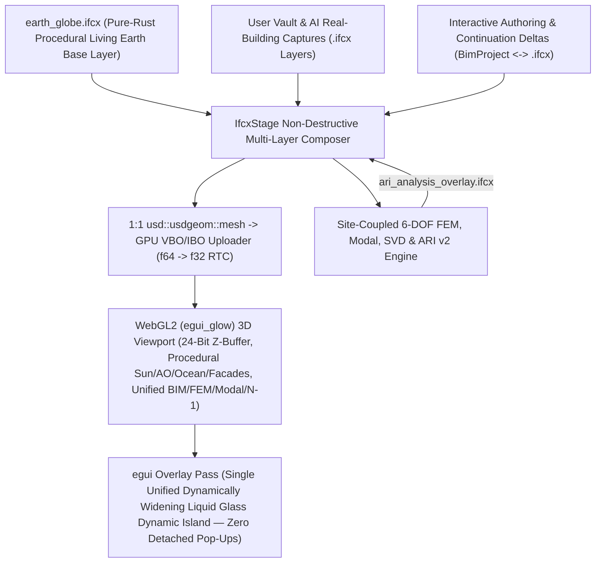

# EigenGraph IFCX Earth — 100% Pure-Rust • 100% Vector • 100% IFCX (IFC 5) Living Earth Structural Simulator

> **Status**: Complete Roadmap Implemented — **`v0.6.4` – `v0.7.5` Delivered** (`v0.7.6` Planned)  
> **Core Architectural Mandate**: **100% Pure Rust • 100% Vector • 100% Pure WebGPU (`wgpu` + WGSL) • 100% IFCX (buildingSMART IFC 5 JSON ECS) • 0% Legacy STEP IFC (`IFC2x3`/`IFC4`/`IFC4.3`) • 0% WebGL • 0% Raster Pixels**  
> **Current Platform**: EigenGraph `v0.7.5` (100% Pure WebGPU/WGSL Renderer, PEER `.at2`/`.csv` Tri-Directional Coupling & Real-Time FEMA P-58 Fragility)  
> **UI Contract Alignment**: Strictly preserves the Single Unified Dynamically Widening Liquid Glass Dynamic Island (zero detached pop-ups) and Edge-to-Edge 3D Earth Viewport defined in [`docs/UI_ARCHITECTURE.md`](UI_ARCHITECTURE.md).

---

## 1. Executive Vision & Core Philosophy

EigenGraph is a **100% self-contained, pure-Rust Vector Earth & OpenBIM IFCX (IFC 5) Structural Simulator** built around one radically simple, modern open standard: **IFCX JSON Entity-Component-System (ECS)**—with **zero legacy STEP `ISO-10303-21` parsers (`IFC2x3`/`IFC4`/`IFC4.3`), zero raster image dependencies, and zero external add-on SDKs**.

Every single entity in the application—from the planetary Earth globe, continents, Indonesian archipelago, mountain ridges, and rivers down to site topography, roads, bridges, multi-story buildings, 6-DOF Finite Element Models, dynamic modal eigenmodes, and Adjusted Redundancy Index (ARI) screening—lives as composable vector nodes in one unified **Living Earth `.ifcx` Scene Graph**.

### Why 100% IFCX (Zero Legacy STEP IFC)?
1. **Radical Architectural Simplicity**:
   - Legacy STEP IFC (`IFC2x3`, `IFC4`, `IFC4.3`) carries 30 years of convoluted `#123=IFCRELCONTAINEDINSPATIALSTRUCTURE(...)` pointer webs, incompatible dialect differences, and thousands of lines of brittle parser boilerplate.
   - IFCX (IFC 5) uses clean, human-readable **JSON ECS documents** (`header`, `imports`, `schemas`, `data`) parsed natively by `serde_json` with **zero extra crates**.
2. **Non-Destructive Multi-Layer Composition ("Continue Drawing on Earth")**:
   - Inspired by OpenUSD's composition arcs, `.ifcx` files stack non-destructively:
     `earth_globe.ifcx` (Base Planet) → `ai_city_capture.ifcx` (Real-World Buildings) → `user_design_delta.ifcx` (User Continuation Edits) → `ari_analysis_overlay.ifcx` (6-DOF FEM & ARI Screening).
   - Opening a project feels like **continuing directly on top of an already-living Earth**—users modify, add, or strengthen structural elements without ever mutating or duplicating base layers.
3. **Future-Ready AI Real-World Building Ingestion**:
   - Because IFCX cleanly separates semantic BIM tags (`bsi::ifc::class`), triangulated vector meshes (`usd::usdgeom::mesh`), world coordinates (`eigengraph::geo::wgs84`), and structural properties (`eigengraph::bim::element`), future multimodal AI vision/3D-reconstruction pipelines can scan real buildings and emit lightweight `.ifcx` layers that drop straight onto EigenGraph's Earth Globe and immediately convert into editable 6-DOF BIM/FEM models.
4. **1:1 Direct Mapping to 100% Pure WebGPU (WGSL) Buffers (Zero WebGL & Zero Raster Pixels)**:
   - Every IFCX node's `usd::usdgeom::mesh` (`points`, `faceVertexCounts`, `faceVertexIndices`, `normals`, `displayColor`) streams directly into `egui-wgpu` / `wgpu` vertex and index buffers rendered via pure WGSL compute/vertex/fragment pipelines (Metal/Vulkan/DX12 Native, Browser WebGPU on `wasm32`) with zero GLSL, zero `glow`, and **0% raster pixels** across the entire Rust/WASM codebase.
5. **Minimal Pure-Rust Stack**:
   - The runtime graphics and persistence core depends cleanly on **`egui` + `eframe` (`wgpu_no_default_features`) + `egui-wgpu` + `wgpu`** and **`serde` + `serde_json`** (plus standard `wasm-bindgen`/`web-sys` on `wasm32`), delivering instant offline load and zero WebGL/GLSL bloat.

---

## 2. Unified Living Earth IFCX Scene Graph

All planetary, urban, architectural, and analytical objects live in a single canonical IFCX path hierarchy:

```text
/earth                                         (IfcProject — Planetary Coordinate Root)
├── /earth/globe                               (IfcSite — Living Vector Earth Base Layer)
│   ├── /earth/globe/ocean                     (IfcGeographicElement + usd::usdgeom::mesh)
│   ├── /earth/globe/landmasses/land_000..     (IfcGeographicElement + usd::usdgeom::mesh)
│   ├── /earth/globe/ridges/ridge_000..        (IfcGeographicElement + usd::usdgeom::mesh)
│   └── /earth/globe/rivers/river_000..        (IfcGeographicElement + usd::usdgeom::mesh)
└── /earth/sites/<site_slug>                   (IfcSite + eigengraph::geo::wgs84 + TIN terrain)
    ├── /earth/sites/<site_slug>/terrain       (IfcGeographicElement + usd::usdgeom::mesh TIN)
    ├── /earth/sites/<site_slug>/roads/...     (IfcRoad + IfcBridge vector corridors)
    └── /earth/sites/<site_slug>/buildings/<id>(IfcBuilding + eigengraph::bim::project)
        ├── .../storeys/L0..Ln                 (IfcBuildingStorey)
        │   ├── .../columns/C1..               (IfcColumn + usd::usdgeom::mesh + bim::element)
        │   ├── .../beams/B1..                 (IfcBeam + usd::usdgeom::mesh + bim::element)
        │   ├── .../walls/W1..                 (IfcWall + usd::usdgeom::mesh + bim::element)
        │   ├── .../slabs/S1..                 (IfcSlab + usd::usdgeom::mesh + bim::element)
        │   └── .../footings/F1..              (IfcFooting + usd::usdgeom::mesh + bim::element)
        └── .../analysis/ari_v2                (eigengraph::ari::v2 + eigengraph::fem::6dof)
```

### Standard & EigenGraph IFCX Attribute Namespaces
| Namespace | Purpose | Example Payload |
| :--- | :--- | :--- |
| **`bsi::ifc::class`** | Official buildingSMART IFC 5 semantic class | `{ "code": "IfcColumn", "uri": ".../IfcColumn" }` |
| **`bsi::ifc::prop`** | Standard naming, marks, materials & metadata | `{ "name": "C1", "material": "Concrete fc' 35 MPa" }` |
| **`usd::usdgeom::mesh`** | Pure-vector 3D triangulated geometry (1:1 WebGL2 VBO/IBO) | `{ "points": [[x,y,z]], "faceVertexCounts": [3], "faceVertexIndices": [0,1,2], "normals": [...], "displayColor": [r,g,b,a] }` |
| **`usd::xformop::transform`** | Local 3D placement transform | `{ "translation": [x,y,z], "rotationDeg": [0,0,heading] }` |
| **`eigengraph::geo::wgs84`** | Planetary georeferencing & UTM metadata | `{ "lat": -6.9175, "lon": 107.6191, "elevM": 768.0, "headingDeg": 0.0, "address": "Bandung" }` |
| **`eigengraph::earth::globe`** | Planetary vector globe theme & feature classification | `{ "theme": "CoastalBlueprint", "kind": "landmass", "region": "Java" }` |
| **`eigengraph::bim::project`** | Lossless parametric `BimProject` snapshot for instant continuation editing | Full parametric levels, walls, columns, beams, slabs, footings, openings |
| **`eigengraph::ari::v2`** | Non-destructive 6-DOF FEM, Modal, SVD & ARI screening overlay | `{ "ariSystem": 0.87, "maxDcrPct": 64.2, "t1Sec": 0.42, "svdDeficiency": 0 }` |

---

## 3. Codebase Cleanup & Legacy Retirement Ledger

### 3.1 Retired Raster Components (Phase 64 — Complete)
- Deleted `image` crate (`png`, `jpeg` and ~10+ transitive raster crates) from `Cargo.toml`.
- Deleted all external raster basemaps (`EsriWorldImagery`, `OpenStreetMap`, `OpenTopoMap`, `CartoDbDarkMatter`), `WorldTileCache`, AWS Terrarium PNG DEM decoders, and Overpass OSM clients.
- Confirmed **0% raster pixels** across `src/` (`ColorImage`, `load_texture`, `painter.image`, `TextureHandle`, `sampler2D`, `texture2D` = 0 occurrences).

### 3.2 Retired Legacy STEP IFC Components (Phase 66 — Complete)
| Retired Legacy Component | Previous Location | Replacement in 100% IFCX Architecture |
| :--- | :--- | :--- |
| **Legacy STEP Lexer/Parser/Editor (`IFC2x3`/`IFC4`/`IFC4.3`)** | `src/core/ifc.rs` (~5,650 lines deleted!) | `src/core/ifcx.rs` — Pure-Rust IFCX JSON ECS engine (`IfcxDocument`, `IfcxStage`) |
| **Legacy STEP `IfcExporter` / `IfcImporter` / `IfcSamExporter`** | `src/core/interop.rs` | `IfcxDocument::from_structural_model` & `IfcxDocument::to_structural_model` |
| **Legacy STEP `export_ifc4_spatial*`** | `src/core/bim.rs` | `BimProject::export_ifcx_spatial*` delegating to `IfcxDocument::from_bim_project` |
| **Legacy STEP Vault Header Scanner** | `src/core/vault.rs`, `index.html` | O(1) JSON `.ifcx` Vault discovery & `eigengraph::geo::wgs84` extraction |
| **Legacy STEP OpenBIM Studio** | `src/views/industrialized/openbim_studio.rs` | Pure-Rust **OpenBIM IFCX (IFC 5) Studio** (Layer Composer, Node Inspector, Health/Clash/Diff, Undo/Redo) |

---

## 4. Target End-to-End System Architecture



---

## 5. Multi-Scale Vector Earth & Four Instant Vector Themes

Because 100% of Earth and buildings live in analytical vector `.ifcx` nodes, crispness stays infinite from orbit (`z0`) to 1 mm structural rebar detailing (`z19`), with four zero-network themes (`VectorEarthTheme`):
1. **`Coastal Blueprint` *(Default)*** — Signature Coastal Marine Teal palette (`#0B1427`, `#2B4963`, `#5B92A5`, `#D0EBE1`).
2. **`City Daylight`** — Crisp daylight city-builder tones with soft directional solar shading and turquoise waters.
3. **`Night Cyber-Twin`** — Deep twilight world with procedural warm lit window bands and luminous structural overlays.
4. **`Topographic Engineering`** — Clean architectural site-plan palette highlighting 6-DOF forces, contours, and `N-1` failure paths.

---

## 6. Phased Implementation Roadmap (`v0.6.4 – v0.7.5`)

Strictly aligned with EigenGraph's sequential semantic versioning rule (`AGENTS.md` — advancing one patch digit per phase):

### Phase 64 (`v0.6.4`) — 100% Pure-Rust Vector Earth & 0% Raster Pixels *(Implemented)*
- Deleted `image` crate, external raster basemaps, AWS Terrarium PNG DEMs, and Overpass API.
- Introduced `VectorEarthTheme`, embedded Natural Earth + detailed Indonesian archipelago vector cartography, and minimalist `EigenGraph` splash screen.

### Phase 65 (`v0.6.5`) — Native WebGL2 (`egui_glow`) 3D Vector Earth Renderer *(Implemented)*
- Added `src/views/webgl_earth.rs` with 24-bit hardware Z-buffer, exact `< 0.05 px` `f64 → f32` Floating-Origin RTC projection, procedural ocean shimmer, building-base AO, procedural glass/night-window facade shaders, and Day/Dusk/Night sun presets.

### Phase 66 (`v0.6.6`) — 100% Pure-Rust IFCX (IFC 5) Engine & Living `earth_globe.ifcx` *(Implemented)*
- **Pure-Rust IFCX JSON ECS Core (`src/core/ifcx.rs`)**:
  - Official buildingSMART IFC 5 / IFCX document model (`header`, `imports`, `schemas`, `data` with `bsi::ifc::class`, `usd::usdgeom::mesh`, `usd::xformop::transform`, `eigengraph::geo::wgs84`, `eigengraph::bim`, `eigengraph::ari::v2`).
  - Non-destructive multi-layer composer (`IfcxStage::compose`) allowing seamless stacking of `earth_globe.ifcx` + AI-captured real buildings + user continuation edits + ARI structural analysis overlays.
- **100% IFCX-Driven 3D Earth Globe**:
  - `IfcxStage::build_earth_globe_layer(theme)` constructs the entire 3D Vector Earth (ocean sphere, continents & Indonesian archipelago, mountain ridges, rivers) as genuine IFCX nodes with `usd::usdgeom::mesh`.
  - `src/views/webgl_earth.rs` renders the planetary globe directly from `earth_globe.ifcx` into GPU VBO/IBO buffers.
- **Complete Legacy STEP IFC Retirement**:
  - Deleted `src/core/ifc.rs` (~5,650 lines of legacy `IFC2x3`/`IFC4`/`IFC4.3` STEP code) and retired all `ISO-10303-21` STEP exporters/importers across `bim.rs`, `interop.rs`, `vault.rs`, `app.rs`, `index.html`, `spatial_workspace.rs`, and `industrialized/`.
  - Upgraded Vault discovery, Dynamic Island `Export .ifcx` / `/ifcx`, and OpenBIM IFCX Studio to 100% `.ifcx`.

### Phase 67 (`v0.6.7`) — IFCX City-Builder Authoring, Unified GPU BIM/FEM Fusion & 100% Unified Dynamic Island *(Implemented)*
- **Unified WebGL2 GPU BIM/FEM/Modal/N-1 Pass (`src/views/webgl_earth.rs`, `src/views/universal_canvas.rs`)**:
  - Active 3D BIM structures (`IfcColumn`, `IfcBeam`, `IfcWall`, `IfcSlab`, and subsurface 3D `IfcFooting` pile caps + deep pile shafts), DCR%/ARI/Moment heatmaps, 60 FPS GPU-animated Deformed Shape & Modal Eigenmodes (`Mode 1–3`), and crimson translucent `N-1` disruption ghost render directly inside the shared 24-bit hardware Z-buffered WebGL2 RTC pass.
- **IFCX City-Builder Authoring (`src/core/gis/city_builder.rs`, `src/core/ifcx.rs`)**:
  - Interactive 2-click vector **Road (`IfcRoad`)** and elevated **Bridge (`IfcBridge`)** authoring with sidewalks, lane markings, and structural piers; 1-click **Parcel Zoning (`IfcSpatialZone`)** with optional context towers and deterministic instanced pure-vector 3D greenery; automatic **Road/Parcel Setback Snapping** for BIM placement; and **Auto Cut/Fill Pad Grading (`IfcSite` TIN)** with 5 m batter slopes and earthwork volume calculation—persisted in `.eigen.json` and losslessly composed into `.ifcx` via `IfcxStage::compose_earth_with_site_and_city`.
- **100% Unified Dynamically Widening Dynamic Island (`src/views/spatial_workspace.rs`, `src/app.rs`, `src/views/settings.rs`)**:
  - Moved **every** Spatial Mode pop-up—Settings & About, Smart Element Inspector, Vault Startup Setup, Unified Workspace Import, CAD Shortcuts/Quick-Jump, and all 15 Engineering Module Sheets—natively inside the single morphing Liquid Glass Dynamic Island (`SpatialIslandHost`), smoothly expanding up to `1040 px` on desktop with zero detached `egui::Window` or `egui::Area` pop-ups and exact centered positioning across Desktop, Tablet, and Mobile.
  - Cleaned Settings → About EigenGraph to display concise semantic versioning (`v0.6.7`) without internal phase labels.

### Phase 68 (`v0.6.8`) — District-Scale Multi-Hazard & AI Real-Building-to-IFCX Streaming *(Implemented)*
- **Pure-Rust District Multi-Hazard Engine (`src/core/gis/district_hazard.rs`, `src/views/webgl_earth.rs`)**:
  - Evaluates animated SNI 1726 / ASCE 7 traveling seismic surface wavefields, phase-lag amplified inter-building pounding corridors, urban Venturi wind channeling streamlines with dynamic pressure (`Pa`), and interactive 3D flood / sea-level inundation planes against `IfcSite` TIN triangles, active ground-floor freeboard, neighbor buildings, and IFCX City-Builder roads/zones—emitting non-destructive `eigengraph::hazard::district` IFCX overlay nodes and GPU depth-masked WebGL2 overlays.
- **Streaming AI Real-Building-to-IFCX Frame Inference & Instant 6-DOF ARI Triage (`src/core/ifcx.rs`, `src/views/spatial_workspace.rs`, `src/app.rs`)**:
  - `IfcxDocument::ingest_ai_real_building_with_frame_inference` consumes exterior AI massing `.ifcx` scans (e.g. `sample_ai_massing_tower_capture_ifcx`) or partial frames, synthesizes multi-storey 3D RC columns, beams, slabs, and footings (`infer_structural_frame_for_bim`), executes instant `FemSolver::solve` + `AriEngine::evaluate_redundancy_fast` screening, and outputs composed `.ifcx` models embedded with `eigengraph::ari::v2` telemetry—accessible directly via the Dynamic Island `Multi-Hazard:` bar and `/seismic`, `/wind`, `/flood`, `/hazard`, `/ai-capture` slash commands.

### Phase 69 (`v0.6.9`) — Automated Structural Retrofit & Non-Destructive `.ifcx` Strengthening Engine *(Implemented)*
- **Pure-Rust Multi-Strategy Retrofit Synthesis (`src/core/retrofit.rs`, `src/core/ifcx.rs`)**:
  - Synthesizes code-informed strengthening options (`AutoBalanced`, `BrbBracingOnly`, `RcJacketingOnly`, `ShearWallCore`) targeting low-ARI / high-DCR bottlenecks via RC column/beam jacketing, pad footing enlargement, 3D Buckling-Restrained Brace (`BRB`) bay injection, and RC Structural Shear Wall infill—verified by site-coupled 6-DOF FEM + `ARI v2` re-analysis with 5D cost (`USD`) & 6D embodied carbon (`kgCO2e`) Pareto scoring.
  - Emits non-destructive `eigengraph::bim::retrofit_delta` `.ifcx` delta layers composable via `IfcxStage::compose_with_retrofit_delta`, with 3D WebGL2 inclined BRB strut rendering (`push_inclined_3d_strut_enu`), interactive Before vs. After comparison, and Dynamic Island `/retrofit`, `/brb`, `/jacket`, `/retrofit-ifcx`, and `/before-after` workflows.

### Phase 70 (`v0.7.0`) — Two-Stage `ARI v2 + StructGNN-CRC` Conformal Screening & Progressive Collapse Cascade *(Implemented)*
- **Dissertation Conformal Screening & Domino Cascade (`src/core/cascade.rs`, `src/core/ifcx.rs`)**:
  - Deploys Stage 1 analytical three-channel `ARI v2` ($w_k=0.25, w_c=0.45, w_d=0.30$) with SVD spectral kinematic guarding ahead of Stage 2 `StructGNN-CRC` ($\alpha=0.05$) conformal risk bounds and Green AI $\text{CO}_2\text{e}$ compute savings telemetry, coupled to UFC 4-023-03 DAF-driven Alternate Path progressive collapse simulation (`PVI`, `Rsys`, residual ARI).
  - Emits non-destructive `eigengraph::analysis::crc_cascade` `.ifcx` overlays composable via `IfcxStage::compose_with_crc_cascade_overlay`, drives WebGL2 step-by-step crimson-orange domino ghosting with gravity sag (`build_rtc_active_bim_fem_mesh`), and integrates interactive `◀ Step` / `Step ▶` chronology controls and `/cascade`, `/crc`, and `/cascade-ifcx` commands directly inside the Single Unified Dynamic Island.

### Phase 71 (`v0.7.1`) — 3D Subsurface Geotechnical Stratigraphy, Coupled 6-DOF Winkler SSI & Modular View Architecture *(Implemented)*
- **Coupled 6-DOF Winkler SSI & Seed–Idriss Liquefaction Kernel (`src/core/model.rs`, `src/core/solver.rs`, `src/core/modal.rs`, `src/core/geotech.rs`, `src/core/bim.rs`)**:
  - Extends `Node3D` & `FemSolver::solve` with coupled 6-DOF foundation Winkler springs (`[kx, ky, kz, krx, kry, krz]`), Veletsos–Meek SSI period lengthening (`T -> T̃`) inside `ModalEngine`, 4 borehole archetypes (`AlluvialSoftClay`, `CoastalLiquefiableSand`, `StiffVolcanicAlluvium`, `DenseGravelBedrock`), harmonic-mean $V_{s30}$ SNI 1726 / ASCE 7 site classification, and Seed–Idriss cyclic liquefaction screening with $p$-$y$ spring degradation.
- **WebGL2 3D Subsurface X-Ray Cutaway & Non-Destructive `.ifcx` Overlay (`src/core/ifcx.rs`, `src/views/webgl_earth/`, `src/views/universal_canvas/`)**:
  - Dynamically extends `BimFooting` foundation pile shafts (`subsurface_pile_depth_m`) into the governing bearing stratum, renders translucent multi-horizon soil strata + borehole BH-01 casing + procedural GLSL sedimentary bedding (`kind >= 3.5`) + animated phreatic groundwater ripples (`kind >= 4.5`) in hardware-Z WebGL2 (with CPU fallback), composes `eigengraph::geotech::stratigraphy` + `eigengraph::geotech::ssi_springs` non-destructively via `IfcxStage::compose_with_subsurface_ssi_overlay`, and refactors view modules into `src/views/{webgl_earth,universal_canvas,spatial_workspace}/`.

### Phase 72 (`v0.7.2`) — Multi-Layer IFCX Visual Diffing & Pure-Vector Engineering Dossier Exporter *(Implemented)*
- **Multi-Layer IFCX Diff Manifest & 3D Ghost Highlighting (`src/core/ifcx.rs`, `src/views/webgl_earth/`, `src/views/universal_canvas/`)**:
  - Evaluates path-by-path, attribute-level semantic diffs across stacked `.ifcx` stages (`BIM Core`, `Subsurface SSI`, `Retrofit Delta`, `CRC Cascade`, `District Hazard`, `City-Builder`), emits non-destructive `eigengraph::ifcx::diff_manifest` nodes (`IfcxStage::compose_with_diff_manifest`), and renders Added (emerald), Modified (amber), and Deleted node AABB ghost volumes (translucent crimson) directly in WebGL2 Pass 2 and CPU fallback.
- **A3 Pure-Vector Engineering Dossier SVG Exporter (`src/core/vector_dossier.rs`, `src/views/spatial_workspace/`, `src/app.rs`)**:
  - Synthesizes 6-panel A3 landscape (`1600 × 1131`, 0% raster pixels) engineering calculation dossiers uniting structural framing plan, storey elevation + subsurface stratigraphy cut, ARI v2 / LRFD DCR% governing chart, multi-physics scorecard, IFCX diff manifest, and SHA-256 integrity seal, driven via `/snapshot`, `/diff`, `/diff-ifcx`, `/dossier` and the widened Dynamic Island Diff Inspector.

### Phase 73 (`v0.7.3`) — Autonomous Portfolio-Scale `ARI v2` Retrofit Optimization Across Multi-Building Districts *(Implemented)*
- **District Portfolio Optimizer & `eigengraph::portfolio::retrofit_plan` Overlay (`src/core/portfolio_retrofit.rs`, `src/core/ifcx.rs`)**:
  - Evaluates coupled structural retrofit strategies across multi-building `.ifcx` district inventories (`WorldSpatialIndex`), solving a constrained Cost (`USD`) vs. Embodied Carbon (`kgCO2e`) vs. District `ARI v2` multi-objective Pareto frontier (`optimize_district_portfolio_retrofit`) and emitting non-destructive `eigengraph::portfolio::retrofit_plan` stages (`IfcxStage::compose_with_portfolio_retrofit_overlay`).
- **3D District Retrofit Crowns & Dynamic Island Pareto Frontier Drawer (`src/views/webgl_earth/`, `src/views/universal_canvas/`, `src/views/spatial_workspace/`, `src/core/vector_dossier.rs`)**:
  - Projects per-building district retrofit status directly in 3D via WebGL2 Pass 2 (`build_rtc_portfolio_retrofit_mesh`) and CPU fallback (glowing emerald/cyan/amber retrofit crowns and deferred crimson alerts), renders a pure-vector Pareto scatter chart (`egui::Painter`) with selectable `F1..Fk` frontier solutions and ranked building cards with `Fly` camera targets inside the widening Dynamic Island `District Portfolio:` drawer, exposes `/portfolio`, `/pareto`, `/budget`, and `/portfolio-ifcx`, and embeds active portfolio KPIs inside exported A3 Pure-Vector Engineering Dossiers.

### Phase 74 (`v0.7.4`) — Real-Time WebWorker / Async Multi-Thread `StructGNN-CRC` & Live Earthquake Ground-Motion Replay *(Implemented)*
- **BIM + SSI-Coupled NL-THA & Cross-Platform Async Background Worker (`src/core/ground_motion_replay.rs`, `src/core/web_bridge.rs`, `index.html`, `src/core/ifcx.rs`)**:
  - Couples active `BimProject`, 6-DOF FEM, `ModalEngine`, and `SubsurfaceSsiAnalysisReport` ($\tilde{T}_1$ period lengthening) to HHT-$\alpha$ nonlinear dynamic time-history integration (`Northridge 1994`, `Kobe 1995`, `El Centro 1940`, `Chi-Chi 1999`, `Sumatra 2004`; Bouc-Wen, Takeda Pinching, Bilinear), dynamic ASCE 41-17 plastic hinge state evaluation, and Two-Stage `ARI v2 + StructGNN-CRC` conformal screening—offloaded cleanly via `AsyncReplayJobManager` (`std::thread::spawn` on Native; inline Blob WebWorker `EigenGraphWorkerBridge` + cooperative time-sliced Rust fallback on `wasm32`) and emitted as non-destructive `eigengraph::analysis::time_history_replay` overlays.
- **60 FPS WebGL2 Story Sway, Pulsing 3D Plastic Hinge Beacons & Dynamic Island Vector Charts (`src/views/webgl_earth/`, `src/views/universal_canvas/`, `src/views/spatial_workspace/`, `src/core/vector_dossier.rs`, `src/app.rs`)**:
  - Drives interpolated 60 FPS structural sway (`EarthBimLens::TimeHistoryReplay`), pulsing octahedral 3D plastic hinge beacons (`hinge_vao/vbo/ibo`, GLSL `kind >= 5.5` with CPU projection fallback), interactive accelerogram/drift/hysteresis pure-vector charts inside the widening Dynamic Island drawer, `/replay`, `/record`, `/hinges`, `/replay-ifcx` commands, and pure-vector A3 dossier telemetry.

### Phase 75 (`v0.7.5`) — 100% Pure WebGPU (WGSL) Renderer, PEER `.at2`/`.csv` Tri-Directional Coupling & Real-Time FEMA P-58 Fragility *(Implemented)*
- **100% Pure WebGPU (`wgpu` + WGSL) Pipeline (`Cargo.toml`, `src/main.rs`, `src/views/webgpu_earth/`, `src/views/universal_canvas/`)**:
  - Removed all WebGL, GLSL ES, `egui_glow`, and `glow` backends; rebuilt 3D Vector Earth rendering in native `wgpu` + WGSL (`WebGpuEarthResources`) with two-pass viewport depth-band splitting (`[0.50, 1.00]` Planet Globe, `[0.00, 0.499]` Floating-Origin RTC Site) across Native Metal/Vulkan/DX12 and Browser WebGPU (`Backends::BROWSER_WEBGPU`), backed by offline CPU vector fallbacks for CI.
- **Custom PEER `.at2`/`.csv` Ingestion, Tri-Directional Coupling & Real-Time FEMA P-58 Fragility (`src/core/{time_history.rs, fema_p58.rs, ifcx.rs, ground_motion_replay.rs, vector_dossier.rs}`, `index.html`, `src/views/spatial_workspace/`)**:
  - Added PEER NGA `.at2` and `.csv` accelerogram parsing, 5%-damped elastic response spectrum with SNI 1726 `Match Sa(T1)` auto-scaling, Tri-Directional `1D X` / `2D XY` / `3D XYZ` ground-motion excitation with vertical $a_z$ axial hinge modulation and 3D WebGPU story sway, real-time BIM+NL-THA FEMA P-58 fragility & per-story repair loss synthesis (`eigengraph::analysis::fema_p58_fragility`, 3D translucent story-loss halos at `material_kind = 7.0`), the `Spectrum & Fragility` Dynamic Island sub-tab with pure-vector charts, and `/at2`, `/tridir`, `/match-sa`, `/fragility`, `/fragility-ifcx` commands.

### Planned Next Phases (`v0.7.6`)
- **Phase 76 (`v0.7.6`) — Live SHM Digital Twin & ATC-20 Post-Earthquake Placard Triage**: Streaming real-time accelerometer/strain-gauge structural health monitoring telemetry against modal baseline fingerprints for automated ATC-20 Green/Yellow/Red placard safety triage directly on Pure WebGPU IFCX Earth.
