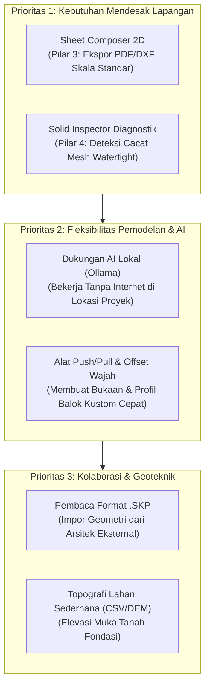

# Analisis Komparasi Fitur: IngeTrazo vs. EigenGraph

> **Dokumen Analisis Arsitektur & Rekayasa Perangkat Lunak**  
> **Referensi Repositori**: [ingelibre/ingetrazo](https://github.com/ingelibre/ingetrazo)  
> **Target Aplikasi**: **EigenGraph** (v1.2.0)  
> **Penyusun**: Antigravity (Google DeepMind Team)  
> **Tanggal**: 1 November 2026  

---

## Executive Summary

**IngeTrazo** (`ingelibre/ingetrazo`) adalah perangkat lunak pemodelan 3D dan BIM berbasis *open-source* (GPL-3.0) yang dikembangkan oleh gerakan **IngeLibre** (diinisiasi oleh insinyur sipil Marco Sumari di Peru). IngeTrazo dirancang sebagai alternatif bebas dan *Linux-first* untuk menggantikan alur kerja **Trimble SketchUp + LayOut + Civil Site Tools**, dengan fokus pada kemudahan menggambar langsung (*direct sketching*), pemodelan tapak lahan, dan penyusunan gambar kerja 2D.

Sebaliknya, **EigenGraph** berakar kuat pada **analisis integritas struktural tingkat lanjut (Finite Element Method / FEM)**, penapisan kestabilan singularitas mekanis (**SVD Kinematic Guard**), formulasi **Adjusted Redundancy Index (ARI)**, simulasi keruntuhan berantai (*Progressive Cascading Collapse*), serta **10 Dimensi Lifecycle BIM** (dari 1D konsep hingga 10D otomatisasi robotik fabrikasi baja).

Meskipun EigenGraph jauh lebih unggul dalam hal mekanika rekayasa numerik, ketahanan struktur, dan otomasi fabrikasi CNC/IFC, **IngeTrazo memiliki sejumlah fitur pemodelan arsitektur bebas, penyiapan dokumen lembar kerja, georeferensi tapak, dan ekosistem plugin yang belum dimiliki oleh EigenGraph**.

Dokumen ini memetakan seluruh fitur IngeTrazo yang belum ada di EigenGraph, dampaknya terhadap pengguna, serta rekomendasi adaptasi strategisnya.

---

## Matriks Perbandingan Ringkas

| Domain Kapabilitas | Fitur di IngeTrazo | Status di EigenGraph | Nilai Tambah jika Diadopsi |
| :--- | :--- | :--- | :--- |
| **Interoperabilitas** | Membaca & Menyimpan format `.skp` (SketchUp 2013–2026) | ❌ Belum Ada (Didukung: IFC 4.3, DXF, DSTV, S2K, JSON) | Sangat Tinggi (Akses jutaan aset 3D Warehouse & arsitek) |
| **Gambar Kerja 2D** | **Sheet Composer** (Pengganti LayOut) dengan multi-skala & vektor PDF | ⚠️ Parsial (Ada 2D Drafting & Section Cut, tanpa Sheet Manager) | Sangat Tinggi (Penerbitan cetak cetak biru teknis resmi) |
| **Pemodelan 3D Bebas** | Push/Pull Watertight, Follow Me (Sweep 3D), Offset Face, Smart Inferences | ⚠️ Parsial (Ada CSG Booleans, Parametrik Truss, Grid/Level Snapping) | Tinggi (Fleksibilitas bentuk non-standar & moulding) |
| **Topografi & Tapak** | Terrain 3D (DEM), Georeferensi UTM, Peta Satelit, Impor CSV Total Station | ❌ Belum Ada (Fokus pada suprastruktur & fondasi bangunan) | Tinggi (Integrasi rekayasa tanah & kontur lereng) |
| **Fotogrametri Drone** | Impor langsung jaring 3D dari **WebODM / OpenDroneMap** (OBJ/glTF) | ❌ Belum Ada | Sedang-Tinggi (Survei kondisi lahan as-built di lapangan) |
| **Diagnostik Geometri** | **Solid Inspector** (Deteksi bocor, non-manifold, reversed faces otomatis) | ❌ Belum Ada (Pengecekan berbasis FEM SVD, bukan diagnostik mesh) | Sedang (Mencegah kesalahan volume QTO pada solid buatan tangan) |
| **Ekosistem Ekstensi** | **Extension Manager** in-app & Python Scripting API terbuka | ⚠️ Parsial (Internal Vault & AI Scripting, tanpa Python runtime/store) | Tinggi (Komunitas dapat membuat plugin kustom mandiri) |
| **Pencahayaan Fasad** | Simulasi Bayangan Matahari (*Sun & Shadow Study*) berbasis tanggal & GPS | ❌ Belum Ada | Sedang (Analisis insolation & estetika fasad arsitektural) |
| **Visualisasi / Kamera** | Scene Manager (Animasi transisi antartampilan) & Link Blender Cycles | ⚠️ Parsial (Viewport orbit/pan standar, tanpa keyframe camera) | Sedang (Presentasi ke klien & visualisasi proyek) |
| **Protokol AI Terbuka** | **MCP (Model Context Protocol) Server** & Multi-LLM (Ollama lokal, Claude, dll.) | ⚠️ Parsial (EigenAI Copilot berbasis Gemini API & Live Vault Context) | Sedang-Tinggi (Otomasi agen eksternal & opsi AI lokal *offline*) |

---

## Rincian Fitur IngeTrazo yang Belum Ada di EigenGraph

### 1. Interoperabilitas Native Format SketchUp (`.SKP`)
* **Deskripsi Fitur**:
  IngeTrazo mampu membuka (*read/parse*) dan menyimpan (*write*) berkas proprietary Trimble SketchUp (`.skp`) dari versi 2013 hingga 2026 tanpa membutuhkan lisensi komersial.
* **Kemampuan Khusus**:
  - Membaca hierarki *Component Instances*, *Groups*, *Tags/Layers*, dan material bertekstur.
  - Mempertahankan koordinat UV texture mapping.
  - Mengizinkan insinyur menggunakan aset model 3D publik dari *3D Warehouse* secara bebas di Linux/macOS/Windows.
* **Ketiadaan di EigenGraph**:
  EigenGraph saat ini membaca format standar terbuka **IFC 4.3**, **DXF**, **DSTV CNC .nc1**, dan berkas input solver **SAP2000 (.s2k)**. EigenGraph belum memiliki mesin pembaca struktur biner `.skp`.

---

### 2. Sheet Composer (Modul Pengganti "SketchUp LayOut")
* **Deskripsi Fitur**:
  IngeTrazo dilengkapi modul terdedikasi bernama **Sheet Composer** untuk menyusun dokumen presentasi gambar kerja teknik 2D siap plot/cetak.
* **Kemampuan Khusus**:
  1. **Kanvas Lembar Kertas Skala Standar**: Mengatur ukuran kertas kerja (A4, A3, A2, A1, A0) dengan orientasi horizontal/vertikal dan margin cetak.
  2. **Viewport 3D Multiskala Interaktif**: Menempatkan beberapa jendela tampilan model 3D di atas satu lembar kertas dengan rasio skala teknik presisi (misal: Tampak Denah 1:100, Potongan 1:50, Detail Buhul 1:20), di mana setiap viewport dapat memiliki gaya tampilan (*style*) independen.
  3. **Exact Vector Hidden-Line Rendering**: Engine rendering garis vektor murni yang menghilangkan garis tersembunyi secara matematis (bukan sekadar tangkapan layar raster piksel), menghasilkan garis cetak ultra-tajam pada resolusi apa pun.
  4. **3 Pen Weights (Ketebalan Pena Teknis)**: Garis otomatis diklasifikasikan ke dalam 3 hierarki: *Cut Lines* (garis elemen terpotong, tebal), *Profile Lines* (garis siluet tepi objek, sedang), dan *Surface Lines* (garis permukaan datar, tipis).
  5. **Section Poché (Pola Arsir Potongan)**: Pengisian pola arsir arsitektur/struktural otomatis pada bidang padat yang terbelah bidang potong (*section plane*).
  6. **Model-Anchored Dimension Chains**: Garis dimensi berantai dan tanda elevasi ($\pm 0.00$, $+3.50$) yang tertambat langsung ke titik acuan elemen 3D; jika dimensi model 3D diubah di kanvas utama, angka dimensi pada lembar kerja ikut terbarui secara parametrik.
  7. **Ekspor Vektor PDF & DXF Berlayer**: Kemampuan menerbitkan lembar kerja ke berkas PDF berbasis kurva vektor murni dan berkas DXF 2D dengan layer garis terpisah sesuai kelas pena.
* **Ketiadaan di EigenGraph**:
  Di Pilar 3 (*Drafting & Drawings*), EigenGraph memiliki kanvas drafting dan sistem proyeksi potongan (*SectionCutProjection*), namun belum memiliki antarmuka penyusunan *paper-space sheet layout* terpadu untuk menerbitkan dokumen gambar kerja cetak multi-skala.

---

### 3. Pemodelan Geometri Bebas (Direct Freeform Modeling UX)
* **Deskripsi Fitur**:
  IngeTrazo mengadopsi filosofi *direct sketch modeling* ("menggambar semudah goresan tangan") yang sangat cepat dan intuitif untuk eksplorasi massa bangunan.
* **Kemampuan Khusus**:
  1. **Push/Pull Tool dengan Hermeticity Guard**: Mengekstrusi permukaan poligon 2D sembarang pada solid menjadi volume 3D, membuat ceruk (*recess*), tangga bertingkat (*step*), atau melubangi solid tembus (*through-hole*). IngeTrazo dilengkapi proteksi hermetisitas otomatis agar solid tidak robek atau menjadi *non-manifold*.
  2. **Follow Me / Sweep Tool**: Menyapu penampang profil 2D tertutup mengikuti jalur kurva atau poliline 3D terbuka/tertutup (sangat penting untuk membuat profil moulding dinding, talang air melengkung, pipa lengkung 3D, atau pegangan tangga putar).
  3. **Offset Face Perimeter**: Menggeser garis tepi bidang poligon masuk atau keluar secara proporsional dengan resolusi perpotongan sudut otomatis untuk memodelkan tebal pelat atau dinding secara instan.
  4. **Smart Inferences & Value Control Box (VCB)**: Kursor menggambar otomatis mendeteksi sumbu ortogonal (garis merah untuk X, hijau untuk Y, biru untuk Z), proyeksi garis paralel/perpendicular, titik tengah garis (*midpoint*), dan perpanjangan garis tepi (*extension*). Pengguna dapat mengetikkan nilai ukuran eksak (misal: `3500mm` atau `150, 300`) di VCB sembari menggerakkan tetikus.
  5. **Tape Measure & Guide Infrastructure**: Alat meteran ukur yang dapat menarik garis bantu putus-putus (*guide lines*) dan titik pandu (*guide points*) tanpa batas di ruang 3D sebagai acuan penempatan elemen.
* **Ketiadaan di EigenGraph**:
  EigenGraph saat ini memodelkan struktur menggunakan pendekatan parametrik rekayasa (input bentang, tinggi, profil WF/HSS, penempatan kolom per grid, dan CSG opening pada dinding). EigenGraph belum memiliki mesin *freeform surface extrusion* interaktif (Push/Pull arbitrary face, Follow Me 3D sweep path, dan garis bantu Tape Measure).

---

### 4. Rekayasa Tapak, Topografi Lahan & Fotogrametri Drone
* **Deskripsi Fitur**:
  IngeTrazo menyertakan modul khusus untuk insinyur sipil lapangan yang menghubungkan model struktur dengan kontur tanah dunia nyata.
* **Kemampuan Khusus**:
  1. **Georeferensi Global & Datum Geografis**: Dukungan koordinat sistem UTM (*Universal Transverse Mercator*), datum WGS84 / SIRGAS, dan penentuan garis bujur/lintang lokasi proyek.
  2. **Web Basemap Integration**: Menampilkan layer citra satelit atau peta jalan interaktif langsung di bawah model 3D sebagai panduan tapak.
  3. **Generasi Medan 3D dari DEM (*Digital Elevation Model*)**: Membaca data elevasi raster DEM/GeoTIFF dan otomatis mengubahnya menjadi permukaan mesh tanah 3D bertopografi nyata.
  4. **Impor Titik Survei Lapangan (CSV Total Station / RTK GPS)**: Menerima berkas koordinat ukur tanah dengan skema format `Nomor Titik, Northing, Easting, Elevasi, Deskripsi` dan langsung membentuk kontur tanah eksisting (*TIN / Triangulated Irregular Network*).
  5. **Trase Jalan & Profil Memanjang (*Longitudinal Alignment & Profile*)**: Penarikan garis sumbu jalan/saluran di atas kontur tanah dengan grafik profil memanjang dan potongan melintang otomatis.
  6. **Integrasi Fotogrametri Drone (WebODM)**: Mengimpor hasil pemindaian drone berupa jaring fotogrametri 3D dari aplikasi *WebODM (OpenDroneMap)* dalam format OBJ/glTF/PLY untuk visualisasi kondisi eksisting lapangan secara fotorealistik.
* **Ketiadaan di EigenGraph**:
  EigenGraph berfokus pada suprastruktur dan pondasi struktur gedung/jembatan. EigenGraph belum memiliki pengolah data kontur topografi, pembaca berkas survei Total Station, trase jalan/saluran, maupun integrasi awan titik (*point cloud*) / jaring fotogrametri drone.

---

### 5. Solid Topology Inspector ("Solid Inspector")
* **Deskripsi Fitur**:
  Utilitas diagnostik otomatis untuk memverifikasi apakah suatu objek 3D benar-benar merupakan benda padat tertutup (*watertight / manifold solid*).
* **Kemampuan Khusus**:
  - **Deteksi Anomali Geometri**: Menemukan tepi berlubang (*open boundary edges*), tepi non-manifold (*edges shared by >2 faces*), bidang terbalik (*reversed normal orientation*), bidang parasit internal (*internal faces*), dan tepi tanpa bidang (*stray edges*).
  - **Reparasi Otomatis 1-Klik**: Menutup celah kecil dan membalikkan orientasi bidang yang terbalik agar volume elemen dapat dihitung dengan akurasi 100% untuk keperluan kubikasi anggaran (QTO).
* **Ketiadaan di EigenGraph**:
  EigenGraph memverifikasi stabilitas melalui **SVD Kinematic Guard** dan rank matriks kekakuan pada derajat kebebasan (DOF) elemen, namun belum memiliki antarmuka visual diagnostik mesh poligon (*Solid Inspector*) untuk mendeteksi dan memperbaiki kecacatan permukaan 3D buatan tangan pengguna.

---

### 6. Ekosistem Plugin Terbuka (Extension Manager & Python API)
* **Deskripsi Fitur**:
  IngeTrazo menyediakan lingkungan pengembangan ekstensi berbasis Python yang modular dan tidak membebani kernel inti aplikasi.
* **Kemampuan Khusus**:
  1. **Extension Manager**: Antarmuka di dalam aplikasi untuk menelusuri katalog online, mengunduh, mengaktifkan, dan memperbarui ekstensi komunitas dengan satu klik.
  2. **Python API & Konsol Interaktif Terintegrasi**: Pengguna dapat membuka konsol Python di dalam aplikasi, mengeksekusi perintah manipulasi geometri, dan setiap eksekusi otomatis dibungkus dalam sistem Undo/Redo atomik.
  3. **Arsitektur "Drop-in Plugin"**: Cukup menaruh berkas `.py` ke dalam direktori `plugins/`, alat baru akan langsung terdaftar di menu *Extensions* saat aplikasi berjalan.
  4. **Katalog Plugin Komunitas**: Sudah tersedia plugin siap pakai untuk pembuat genteng atap parametrik (*Roof Tile Generator*), kabinet dapur modular, chamfer/fillet kurva, serta pembaca/penyimpan format CAD mekanikal STEP/IGES.
* **Ketiadaan di EigenGraph**:
  EigenGraph memiliki arsitektur Rust yang sangat cepat, memori *KnowledgeBase*, *InternalVault*, dan bus perintah transaksional (*BimCommandBus*). Namun, EigenGraph belum memiliki *runtime* bahasa dinamis (seperti Python) untuk plugin eksternal dan belum memiliki toko/manajer ekstensi daring untuk komunitas pihak ketiga.

---

### 7. Pengaturan Material, UV Mapping, dan Studi Bayangan Matahari
* **Deskripsi Fitur**:
  Alat penunjang estetika dan presentasi arsitektural di lingkungan 3D.
* **Kemampuan Khusus**:
  - **Material & Texture Mapping**: Pengaturan tekstur bitmap foto (bata, beton, kayu, aspal) dengan proyeksi UV bidang (*planar*), silinder (*cylindrical*), atau kotak (*box mapping*).
  - **Sun & Shadow Engine Real-Time**: Perhitungan posisi sudut matahari (azimut dan elevasi) berdasarkan lokasi koordinat geografis proyek, tanggal kalender, dan waktu (jam). Bayangan jatuh secara dinamis di atas model dan kontur tanah.
  - **Scene Manager & Camera Transitions**: Menyimpan sudut pandang kamera, visibilitas elemen, dan mode render ke dalam tab adegan (*scenes*) yang dapat diputar halus menjadi animasi penelusuran (*walkthrough*).
  - **Bridge Rendering Blender Cycles**: Kemampuan mengekspor berkas kamera dan material ke Blender untuk proses *ray-tracing* fotorealistik tingkat tinggi.
* **Ketiadaan di EigenGraph**:
  EigenGraph memvisualisasikan elemen dalam bentuk diagram mekanika teknik (gaya aksial, lendutan, rasio tegangan DCR, kontur ARI, dan mesh BIM fungsional). EigenGraph belum menyertakan kalkulator posisi matahari untuk bayangan fasad real-time, editor tekstur UV fotorealistik, maupun animator kamera adegan.

---

### 8. Arsitektur AI Multi-Provider & Endpoint MCP Terbuka
* **Deskripsi Fitur**:
  IngeTrazo menyertakan asisten kecerdasan buatan (*AI Assistant*) yang fleksibel dan berorientasi protokol terbuka.
* **Kemampuan Khusus**:
  - **Multi-LLM Provider**: Mendukung konfigurasi kunci API untuk OpenAI GPT, Anthropic Claude, Google Gemini, Groq, DeepSeek, OpenRouter, serta inferensi lokal menggunakan **Ollama** (memungkinkan AI berjalan 100% *offline* di laptop lapangan tanpa koneksi internet).
  - **MCP (Model Context Protocol) Server**: Menyediakan jembatan server MCP sehingga agen AI eksternal (seperti Antigravity, Claude Desktop, atau Cursor) dapat menginspeksi, memodifikasi, dan mengendalikan dokumen gambar aktif secara terprogram.
* **Ketiadaan di EigenGraph**:
  EigenGraph memiliki Copilot internal cerdas yang terhubung dengan Google Gemini API dan grounding ke status Vault aktif. Namun, EigenGraph belum menyediakan pilihan multi-provider (seperti integrasi langsung ke Ollama lokal untuk kerja tanpa internet) dan belum mengekspos endpoint **MCP Server** ke sistem operasi lokal agar dapat dikendalikan oleh agen AI eksternal.

---

## Rekomendasi Adaptasi Strategis untuk EigenGraph

Dari analisis komparasi di atas, tidak semua fitur IngeTrazo perlu dijiplak secara mentah-mentah ke dalam EigenGraph. EigenGraph adalah perangkat lunak **Structural Engineering & 10D BIM** berpresisi tinggi. Namun, beberapa fitur berikut akan memberikan **daya saing eksponensial** jika diadopsi ke dalam roadmap rilis EigenGraph berikutnya:

### Rekomendasi Aksi Konkret:
1. **Adopsi Modul "Sheet Composer" di Pilar 3 (Drafting & Drawings)**:
   Tambahkan kanvas lembar kerja standar (A3/A4) di mana pengguna dapat meletakkan denah dan potongan rangka dari kanvas 3D, memilih skala teknis (1:50, 1:100), dan mengekspornya langsung ke berkas PDF vektor berkualitas tinggi lengkap dengan kop surat (*title block*) proyek.
2. **Tambahkan Alat Diagnostik "Solid Inspector" di Pilar 4**:
   Integrasikan pemeriksa watertight mesh pada modul CSG untuk mendeteksi apakah pelat atau balok beton yang dimodelkan memiliki lubang kebocoran permukaan sebelum dilakukan perhitungan volume kubikasi beton di Pilar 6 (Cost & Budgeting).
3. **Ekspansi AI Copilot ke Mode Offline (Ollama Bridge)**:
   Berikan opsi pada pengaturan AI Copilot EigenGraph untuk beralih antara Google Gemini (cloud dengan kecepatan tinggi) dan model Ollama lokal (seperti `deepseek-r1` atau `qwen2.5-coder`) agar insinyur tetap dapat berkonsultasi mengenai integritas struktur saat berada di lokasi proyek terpencil tanpa akses internet.
4. **Modul Elevasi Kontur Tapak untuk Pilar 8 (Facility) & Pondasi**:
   Sediakan fitur impor sederhana berkas CSV titik ukur elevasi tanah asli agar elevasi kedalaman fondasi telapak (*footing*) di kanvas BIM terhubung langsung dengan muka air tanah dan kontur permukaan tanah setempat.

---

## Kesimpulan

**IngeTrazo** unggul dalam filosofi **arsitektur sketsa bebas, kemudahan pembuatan dokumen gambar 2D (Sheet Composer), rekayasa tapak sipil, dan keterbukaan ekosistem plugin**.

Di sisi lain, **EigenGraph** adalah **raksasa analisis struktural** dengan keunggulan mutlak yang tidak dimiliki oleh IngeTrazo:
- Evaluasi Redundansi dan Ketahanan Keruntuhan (**Adjusted Redundancy Index / ARI**).
- Penapisan Mekanisme Kinematis Singularity (**SVD Kinematic Guard**).
- Analisis Seismik Dinamik Ragam Getar (**SNI 1726:2019**).
- Analisis Non-Linier Pushover P-Delta (**AISC 360-16 / FEMA 356**).
- Sertifikasi Kriptografi NIST SHA-256 Tamper-Proof.
- Fabrikasi Robotik Baja Berstandar Industri (**DSTV CNC .nc1**).
- Ekspor Standar Tertinggi OpenBIM (**IFC 4.3 Add2**).
- Siklus Hidup Konstruksi Lengkap (**10D BIM** terintegrasi).

Dengan mengadopsi fitur-fitur esensial IngeTrazo—khususnya **Sheet Composer** untuk gambar kerja teknis, **alat bantu pemodelan langsung Push/Pull**, dan **fleksibilitas AI lokal tanpa internet**—EigenGraph akan menjadi ekosistem perangkat lunak teknik sipil dan struktur yang tidak tertandingi di industri global.
