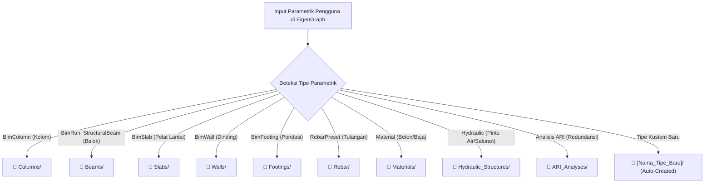

# ⚛️ Arsitektur & Rencana Sistem Vault EigenGraph (Obsidian-Style)

Dokumen ini merinci arsitektur, struktur data dinamis, dan peta jalan implementasi untuk **Sistem Vault Terbuka EigenGraph** yang mengadopsi prinsip **Obsidian**:
1. **Lokasi Bebas Dipilih Pengguna**: Tidak ada lokasi default kaku. Pengguna bebas menentukan folder di mana saja (Desktop, Documents, Google Drive, Dropbox, atau SSD Eksternal).
2. **Kategori Folder Otomatis Sesuai Tipe Parametrik**: Pengguna tidak perlu membuat folder manual. Saat pengguna membuat kolom, balok, pelat, atau tulangan di EigenGraph, sistem secara otomatis membuatkan dan mengarahkan file ke folder kategori parametrik yang bersangkutan.

---

## 1. Filosofi & Visi Inti

```
+-------------------------------------------------------------+
|               EigenGraph Engine (Biner Mandiri)             |
|   - Ukuran: ~15 MB (Universal 2: M1/M2/M3/M4 & Intel)       |
|   - Lokasi: /Applications/EigenGraph.app                     |
|   - Sifat: Imutabel, super cepat, 1-Click Update mulus       |
+-------------------------------------------------------------+
                              |
     Pengguna Bebas Memilih Folder Vault (Native Dialog)
                              v
+-------------------------------------------------------------+
|      EigenGraph Vault (Ditentukan Pengguna & Auto-Routed)    |
|   - Lokasi: Bebas (SSD Eksternal / Google Drive / Folder Apa Saja)
|   - Subfolder: Otomatis dibuat saat elemen parametrik dibuat|
|   - Format: Standar terbuka (JSON, glTF, IFC, Python)       |
|   - Sifat: Self-enriching, no lock-in, zero junk risk       |
+-------------------------------------------------------------+
```

---

## 2. Pemilihan Lokasi Vault (Bebas & Fleksibel)

* **Bebas Memilih Folder Mana Saja**:
  * Saat pertama kali membuka aplikasi, atau melalui **Pilar 1: `📁 My Library`**, pengguna dapat mengklik tombol:
    `[📂 Pilih / Hubungkan Folder Vault]`
  * Membuka *Native macOS Finder / Windows File Dialog* (`rfd`).
  * Pengguna bisa memilih folder kosong di:
    * Harddisk internal (misal di folder proyek mana pun).
    * Folder sinkronisasi cloud: **Google Drive**, **Dropbox**, **OneDrive**, atau **iCloud Drive**.
    * **SSD Portable / Flashdisk Eksternal** (sangat berguna jika laptop memiliki kapasitas SSD terbatas).
* **Penyimpanan Preferensi**:
  * Path folder yang dipilih disimpan di preferensi lokal aplikasi (`~/.config/eigengraph/vault_config.json`), sehingga saat aplikasi dibuka kembali, EigenGraph langsung terhubung ke Vault tersebut.
  * Pengguna bisa berganti Vault kapan saja (misal: *Vault_Proyek_Air* berganti ke *Vault_Proyek_Gedung*).

---

## 3. Sistem Kategori Folder Dinamis & Otomatis (*Auto-Taxonomy Routing*)

Pengguna tidak perlu pusing memikirkan manajemen folder. Setiap kali sebuah objek atau parametrik dibuat di EigenGraph, modul Vault secara otomatis mendeteksi tipe parametriknya dan menyimpannya ke folder yang sesuai:



### Pemetaan Otomatis Elemen ke Subfolder:

| Tipe Parametrik di EigenGraph | Subfolder Otomatis | Contoh Berkas yang Dihasilkan |
|---|---|---|
| **Kolom Beton / Baja (`BimColumn`)** | `Columns/` | `Kolom_Persegi_50x50_K350.json`, `Kolom_Spiral_D60.gltf` |
| **Balok Struktur (`StructuralBeam`)** | `Beams/` | `Balok_T_30x60.json`, `WF_400x200.json` |
| **Pelat Lantai (`BimSlab`)** | `Slabs/` | `Pelat_Lantai_T12cm.json` |
| **Dinding Geser / Pasangan (`BimWall`)** | `Walls/` | `Shearwall_T25cm.json`, `Dinding_Bata.json` |
| **Pondasi Telapak / Tiang (`BimFooting`)** | `Footings/` | `Pilecap_4_Tiang.json`, `Footing_2x2m.json` |
| **Pola Penulangan (`RebarPreset`)** | `Rebar/` | `Sengkang_Gempa_135deg_D10.json`, `Tulangan_Kolom_12D22.json` |
| **Material Bahan (`Material`)** | `Materials/` | `Beton_fc30_Tahan_Sulfat.json`, `Baja_BJTS420.json` |
| **Struktur Air / Hidrolika** | `Hydraulic_Structures/` | `Pintu_Air_B150_H200.json`, `Box_Culvert_2x2m.json` |
| **Hasil Analisis Keruntuhan / ARI** | `ARI_Analyses/` | `Benchmark_ARI_Portal_3Lantai.json` |
| **Proyek Utuh** | `Projects/` | `Proyek_Irigasi_Primer_2026.egproj` |

> [!TIP]
> Jika pengguna membuat tipe komponen baru di masa depan yang belum ada di daftar di atas (misalnya `RetainingWall` atau `CableStayed`), sistem secara cerdas akan langsung membuatkan folder `Retaining_Walls/` secara otomatis tanpa perlu campur tangan pengguna.

---

## 4. Keamanan Folder & Pencegahan Dianggap "File Sampah"

Di dalam folder Vault yang dipilih pengguna, sistem otomatis menyertakan:
1. **Icon Khusus Logo EigenGraph** (Logo atom ⚛️ agar tampil eksklusif di Finder / File Explorer).
2. **File Penjelas Otomatis: `BACA_SAYA_JANGAN_HAPUS.txt`**:
   ```text
   ======================================================================
   ⚛️ EIGENGRAPH ASSET & ENGINEERING KNOWLEDGE VAULT
   ======================================================================
   Folder ini adalah Basis Data Pustaka Parametrik Anda.
   Seluruh kolom, balok, tulangan, dan analisis yang Anda buat di
   EigenGraph tersimpan secara otomatis dan terorganisir di sini.

   JANGAN MENGHAPUS FOLDER INI agar data aset proyek Anda tidak hilang.
   ======================================================================
   ```
3. **Pemisahan Cache**: File sementara (*cache GPU*, *mesh temporary*, *render log*) dibuang ke folder sistem tersembunyi (`~/Library/Caches/EigenGraph/`), sehingga Vault hanya berisi data berharga murni milik pengguna.

---

## 5. Peta Jalan Implementasi Teknis (Roadmap)

### Tahap 1: Modul Vault Engine (`src/core/vault.rs`)
- [ ] Buat struct `VaultManager` dengan fungsi:
  - `set_vault_path(path: PathBuf)`: Menyimpan dan memuat path vault pilihan pengguna.
  - `auto_route_element(category: &str, element_data: &T)`: Mendeteksi kategori elemen dan otomatis membuat folder kategori jika belum ada (`std::fs::create_dir_all`).
  - `write_protection_notice(vault_path: &Path)`: Menuliskan file `BACA_SAYA_JANGAN_HAPUS.txt`.
- [ ] Serialisasi data parametrik ke JSON (`serde_json`).

### Tahap 2: Integrasi UI di Pilar 1 (`📁 My Library`)
- [ ] Tambahkan tombol `📂 Pilih Folder Vault` (menggunakan file picker bawaan OS).
- [ ] Tampilkan daftar folder otomatis (`Columns/`, `Beams/`, `Rebar/`, dll.) dan isi komponennya dalam bentuk kartu pratinjau (*component cards*).
- [ ] Pastikan tidak melanggar aturan penguncian UI Left Sidebar di `src/app.rs`.

### Tahap 3: Fitur 1-Click "Save to Vault" pada Modeling
- [ ] Pada panel pemodelan (Pilar 4), tambahkan tombol: `💾 Simpan Komponen ke Vault`.
- [ ] Elemen langsung masuk ke subfolder yang sesuai secara instan.
